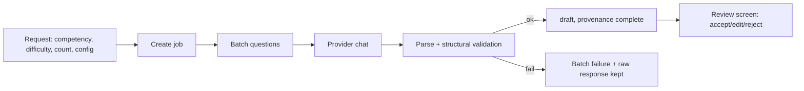

# Question Generation

Canonical source for the **generation pipeline**: how a request becomes draft questions in the Bank
Soal. Referenced by [QUESTION_SPECIFICATION.md](../examination/QUESTION_SPECIFICATION.md) §6 and
[PRD.md](../product/PRD.md) §8.4 (FR-G1…FR-G6).

The prompt text is canonical in [PROMPT_SPECIFICATION.md](./PROMPT_SPECIFICATION.md); the provider
interface in [AI_PROVIDER_ARCHITECTURE.md](./AI_PROVIDER_ARCHITECTURE.md). This file owns the pipeline
and its failure taxonomy; the backend execution lives in [GENERATION_JOBS.md](../backend/GENERATION_JOBS.md).

---

## 1. Pipeline

1. **Request** names `competencyIds` (leaves), `difficulty`, `count`, `configId`.
2. **Job** records `providerId`, `modelId`, `promptTemplateId`, `promptVersion`, `generationId`.
3. **Batching** splits `count` into batches sized so review stays ≤ 60 s/question
   ([PRD.md](../product/PRD.md) §12); a batch is the unit of retry and of failure.
4. **Every produced question arrives as `draft`** with a complete `provenance` block — never `active`
   (US-B2). Regenerating creates a **new** question whose `generationId` differs; it never mutates the
   old one in place.

## 2. Provenance on arrival

Each draft pins: provider, model, prompt template + version, generation id, timestamp. This is the
`provenance` block of [QUESTION_SPECIFICATION.md](../examination/QUESTION_SPECIFICATION.md) §2; the
"never official" badge and prohibited-strings rules in §2.1 are enforced here on arrival.

## 3. Structural validation on arrival

Before a draft is shown to the user it passes [AI_VALIDATION.md](./AI_VALIDATION.md); then, once the
user accepts content, the full [QUESTION_SPECIFICATION.md](../examination/QUESTION_SPECIFICATION.md)
§5 check set (V-01…V-12) gates `active`. A draft that fails a blocking validation is still shown as
failed, with the check and message, so the user can edit — never silently dropped (FR-G3, US-B6).

## 4. Batching and cancellation

- Progress shows batches done/total; cancel stops **further** batches and keeps completed ones
  (FR-G2, US-B1).
- A cancelled batch never half-writes: a batch is committed atomically (all its drafts or none), and a
  failed batch is marked failed with its raw response retained for inspection.

## 5. Failure taxonomy (canonical ids)

| Category | Meaning | Retry? |
|---|---|---|
| `timeout` | provider exceeded `timeoutMs` | yes |
| `auth` | 401/403 — key rejected | no (until key fixed) |
| `rate_limit` | 429 | yes, honoring retry cap |
| `malformed_json` | non-JSON or wrong schema despite contract | yes (regenerate) |
| `schema_violation` | JSON parsed but fails structural validation | yes (regenerate) |
| `provider_error` | any other provider/transport failure | yes |

The raw response is always viewable (FR-G6). `malformed_json` and `schema_violation` are distinct:
one is "not JSON", the other is "JSON of the wrong shape" ([AI_VALIDATION.md](./AI_VALIDATION.md)).

## 6. Regeneration

Regenerating one question issues a new job/batch with the same parameters; the result is a **new**
draft row. The original is kept (or rejected/archived by the user), so no provenance record is
overwritten.