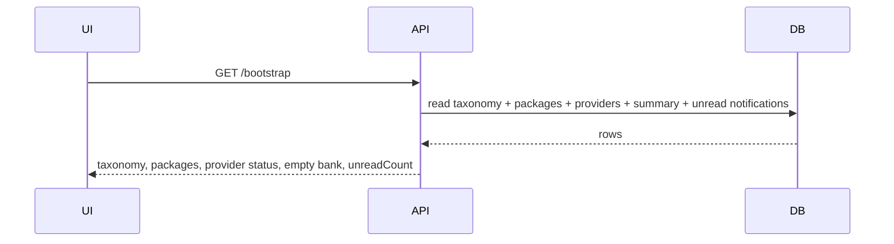
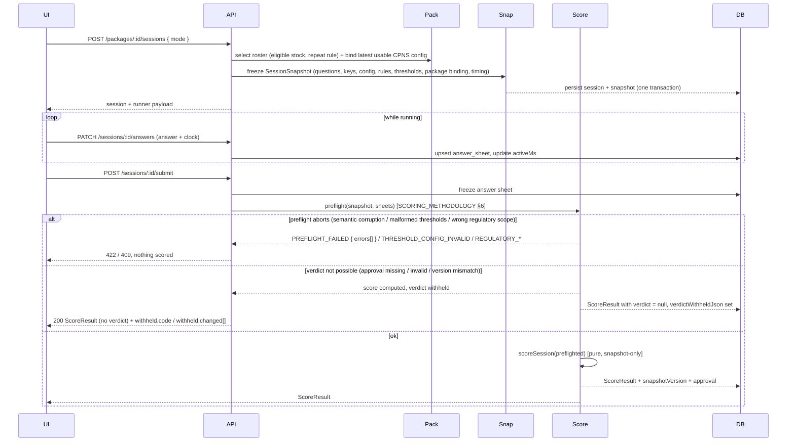
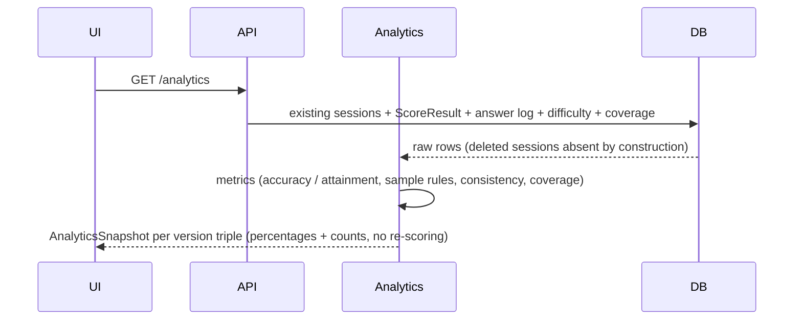
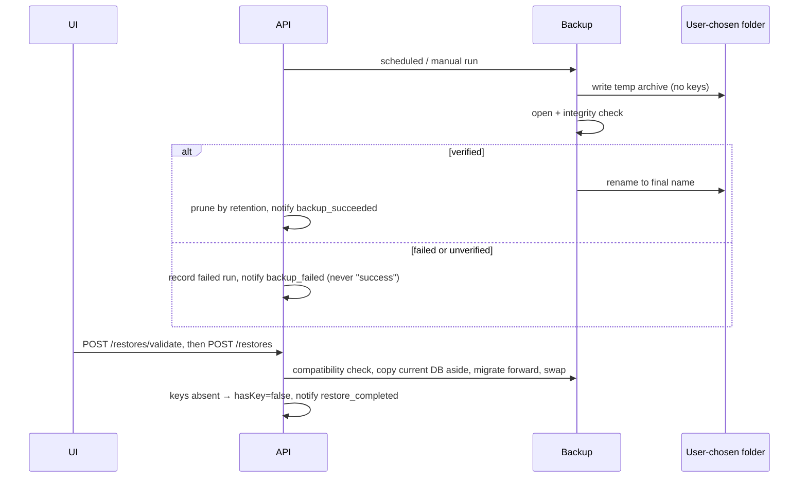

# Data Flow

Canonical source for the **end-to-end data flows** that cross component boundaries. Each flow is one
Mermaid sequence; layer responsibilities stay in the components' own docs, not restated here.

---

## 1. Bootstrap (first run → dashboard)



Bootstrap carries **no exam-config list**: the learner never selects a config
([PACKAGE_SPECIFICATION](../product/PACKAGE_SPECIFICATION.md) §3).

## 2. Generate questions

```mermaid
sequenceDiagram
  participant UI
  participant API
  participant Jobs
  participant Provider
  participant DB
  UI->>API: POST /generation-jobs
  API->>Jobs: enqueue (server-owned; browser may close)
  loop each batch
    Jobs->>Provider: chat (prompt template)
    Provider-->>Jobs: raw response
    Jobs->>Jobs: T → Q → K [AI_VALIDATION]
    Jobs->>DB: commit batch atomically (drafts / quarantined)
  end
  Jobs->>DB: job report (partial counts) + notification
  UI->>API: GET /notifications (poll)
  API-->>UI: job outcome
```

## 3. Start + score a session (the score pipeline)



`submit` always produces a score unless the snapshot itself is unusable. A missing approval withholds the
**verdict only**; `/score` is used after a genuine abort or to add a verdict
([API_SPECIFICATION](../backend/API_SPECIFICATION.md) §7.3).

## 4. Analytics



## 5. Recommendations → learning sequence

```mermaid
sequenceDiagram
  participant Analytics
  participant Reco
  participant AI as AI provider (optional)
  participant DB
  Analytics->>Reco: AnalyticsSnapshot
  Reco->>Reco: rank strengths/weaknesses (closed set; reportable only)
  Reco->>DB: read approved materials by competency
  Reco->>AI: analysis task with the CLOSED weakness list (optional)
  AI-->>Reco: studyOrder permutation + explanation text
  Reco->>Reco: validate permutation; discard anything outside the input set
  Reco-->>UI: strengths + weaknesses + evidence + MaterialOffer + ordered sequence with reason (no plan document)
```

If the AI step fails or is unmapped, the flow returns the deterministic result with no narrative — the
result screen never blocks on a provider.

## 6. Sampling gate

```mermaid
sequenceDiagram
  participant UI
  participant API
  participant DB
  UI->>API: GET /question-batches
  API-->>UI: batch + sample + flags
  UI->>API: POST /question-batches/:batchId/sample { outcome }
  API->>DB: sampling record; dynamicEligible = true for the eligible set
  API->>DB: notification resolved (batch_awaiting_sampling)
```

## 7. Backup and restore



## 8. History deletion

```mermaid
sequenceDiagram
  participant UI
  participant API
  participant DB
  UI->>API: GET /sessions/:id/deletion-impact
  API-->>UI: what will change (plain language)
  UI->>API: DELETE /sessions/:id (after explicit confirm)
  API->>DB: delete session + snapshot + answers + result, insert tombstone (one transaction)
  API-->>UI: 204; analytics re-read on next request
```

---

## Invariants visible across flows

- The score pipeline reads **only** the snapshot (flow 3); no flow reads the live bank/config into a
  score.
- Analytics never feeds a score back; flows 3 and 4 are one-directional. Flow 5 consumes flow 4's
  `AnalyticsSnapshot` unchanged (including `sessionCount` and `testMean`), never re-aggregating.
- Flow 5 may **order and explain** the closed weakness set; it can never add a competency to it.
- Flows 2 and 6 change only the question pool; no generation path writes a score or an analytics value.
- Flow 7 copies data out and in; it never recomputes a result and never moves a key.
- Flow 8 is the only path by which a stored result disappears, and it is always a user act
  ([ANALYTICS_ENGINE](../backend/ANALYTICS_ENGINE.md) §7).
