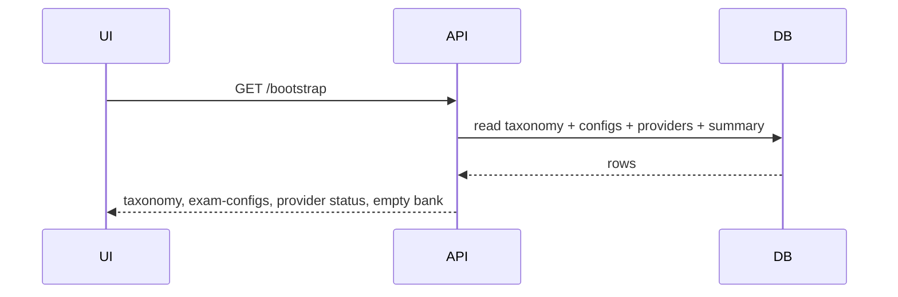
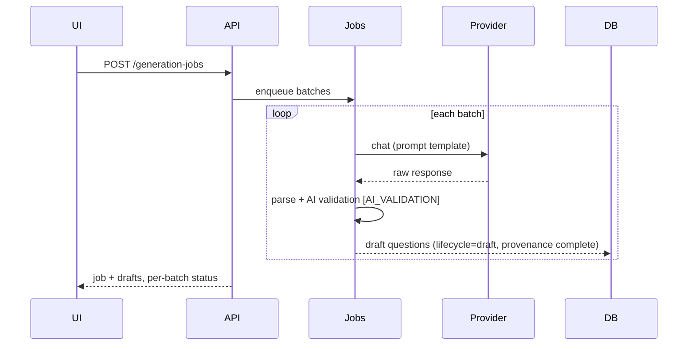
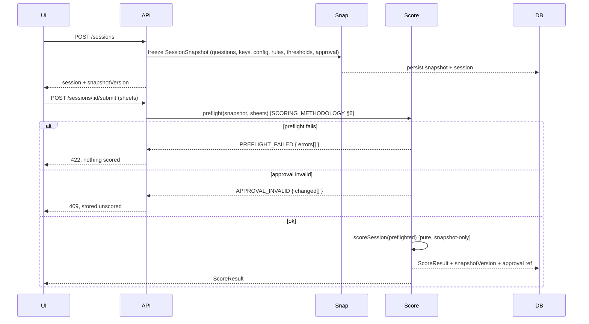
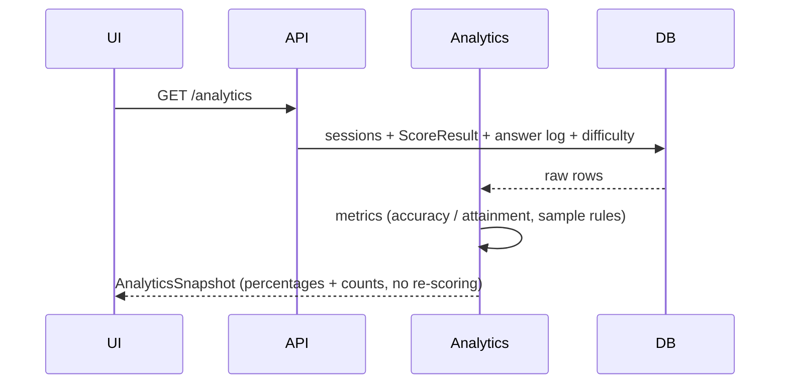
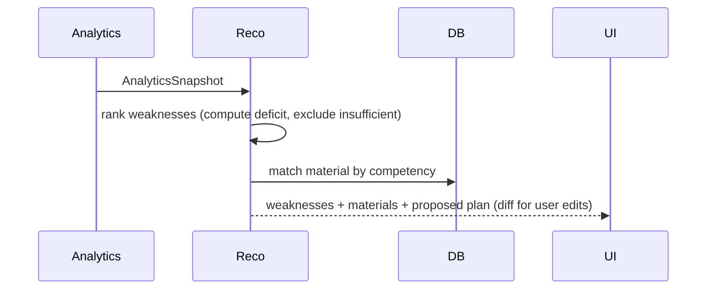

# Data Flow

Canonical source for the **end-to-end data flows** that cross component boundaries. Each flow is one
Mermaid sequence; layer responsibilities stay in the components' own docs, not restated here.

---

## 1. Bootstrap (first run → dashboard)

## 2. Generate questions

## 3. Start + score a session (the score pipeline)

## 4. Analytics

## 5. Recommendations → study plan

---

## Invariants visible across flows

- The score pipeline reads **only** the snapshot (flow 3); no flow reads the live bank/config into a
  score.
- Analytics never feeds a score back; flows 3 and 4 are one-directional.
- Provider output (flow 2) cannot reach scoring/analytics flows.