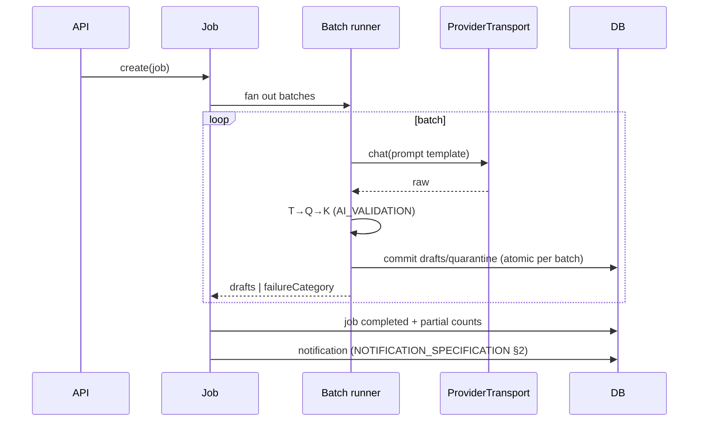

# Generation Jobs

Canonical source for the question-generation **job lifecycle and execution model**, and for how a job
behaves across navigation, browser close and app restart. The AI-output pipeline (prompt → validate) is
[QUESTION_GENERATION.md](../ai/QUESTION_GENERATION.md); this file is the **backend job** that runs it.

---

## 1. Job model

A job asks for **N questions for a competency set** (FR-G1); the backend splits it into **batches**
because a single provider call producing N question-entities reliably is fragile. Batches map
call → drafts:



Layer order (T: parse + shape + V-01..V-13 → Q → K → sampling) is
[QUESTION_SPECIFICATION.md](../examination/QUESTION_SPECIFICATION.md) §5 and
[AI_VALIDATION.md](../ai/AI_VALIDATION.md) §1.

**Execution is server-owned.** The job runs in the backend process, not in the browser. The user may
navigate anywhere in the app or close the browser; the job is unaffected, and its outcome is delivered
through the in-app notification centre ([NOTIFICATION_SPECIFICATION.md](./NOTIFICATION_SPECIFICATION.md)
§2 `generation_completed` / `generation_failed` / `batch_awaiting_sampling`).

## 2. Status model

| status | meaning |
|---|---|
| `queued` | created, not started |
| `running` | some batches in flight |
| `completed` | every batch resolved (drafts or `failureCategory`); may be `partial` (§3) |
| `failed` | job-level failure (no batch could run) |
| `interrupted` | the app stopped while at least one batch was in flight and could not be resumed safely (§5) |

```ts
type JobStatus = 'queued' | 'running' | 'completed' | 'failed' | 'interrupted';
```

- The set is **closed**; a new status is an API-contract change recorded in
  [../AUDIT.md](../AUDIT.md).
- `interrupted` is not a terminal failure: it always carries a retry action (§5).
- **No pause, no resume, no cancel.** MVP generation jobs support none of the three
  (Product Owner decision, 2026-11-08). A running job runs to completion; the user may navigate away or
  close the browser and the job continues (§1). This is unrelated to the **exam-session** clock, which
  does pause and resume ([SCORING_METHODOLOGY](../examination/SCORING_METHODOLOGY.md) §8.1) — that
  behaviour is unchanged.
- There is no cancel route, no `cancelling` status and no cancelled batch state. Batches end
  `completed`, `failed` or `interrupted` only.
- A batch carries `failureCategory` from [QUESTION_GENERATION](../ai/QUESTION_GENERATION.md) §6; the
  job aggregates counts.

## 3. Output, partial results and reporting

```ts
type JobReport = {
  jobId: string;
  status: JobStatus;
  batches: Array<{ batchId: string; status: 'completed' | 'failed' | 'interrupted';
                   produced: number; quarantined: number; failureCategory?: string }>;
  produced: number;          // questions written by this job
  quarantined: number;       // written, but failing a validation layer
  partial: boolean;          // true iff some batch failed/interrupted and produced > 0
  awaitingSampling: boolean; // true while the batch gate is unsatisfied
};
```

- Drafts arrive at lifecycle `draft` (or `ai_validated` / `quarantined` after the pipeline) with
  provenance-on-arrival (BR-Q1); they are **never** `active` on arrival (FR-G4,
  [QUESTION_SPECIFICATION](../examination/QUESTION_SPECIFICATION.md) §3).
- **Partial output is kept and reported.** A failure after some batches succeeded never discards those
  questions; the job report carries `partial: true` and per-batch counts.
- **No token, cost or rate reporting.** The job view shows status, counts, batches and failures only
  ([AI_PROVIDER_ARCHITECTURE](../ai/AI_PROVIDER_ARCHITECTURE.md) §9).
- Generation size is bounded by the model's detected `maxContextTokens`; a small context yields more,
  smaller batches, never a truncated prompt.
- Regeneration is a new job with `count: 1` whose draft carries `regeneratesQuestionId`; it is a new
  `question` row with its own provenance, never an edit of the original
  ([QUESTION_GENERATION](../ai/QUESTION_GENERATION.md) §8, AI-3).

## 4. Persistence shape

Two tables: `generation_job` (job row + status + counters) and `generation_batch` (one row per batch:
status, produced/quarantined counts, failure category, scrubbed raw response ref). The shape is owned by
[DATABASE_SCHEMA.md](./DATABASE_SCHEMA.md); the logical requirement here is that a **batch is the atomic
unit** — a batch either commits all of its drafts or none.

## 5. Restart and crash recovery

A provider request **cannot be resumed mid-flight**, and the product never claims otherwise. On start the
backend runs this inspection before reporting ready
([DEPLOYMENT_AND_BACKUP.md](../architecture/DEPLOYMENT_AND_BACKUP.md) §1.2 step 4):

| Leftover state | Decision | Reason |
|---|---|---|
| `queued` job (nothing sent) | resume normally | no provider request exists yet |
| `running`, batch **not yet sent** | resume that batch | safe: nothing to duplicate |
| `running`, batch **sent, no response recorded** | mark batch `interrupted`, job `interrupted` | the provider may or may not have generated; retrying is a **new** request, so the user chooses |
| `running`, batch **committed** | keep its questions; continue with the next batch | output already durable |
| `completed` / `failed` | untouched | terminal |

Rules:

1. **Resume only what is technically safe**; everything else becomes `interrupted` with an explicit
   retry action.
2. **Partial results are kept** (§3) — an interrupt never deletes written questions.
3. **No duplicate questions.** Retrying an interrupted batch re-inserts under the same
   `(generationId, batchId, promptVersion)` and is rejected by `contentHash` (V-08) if the provider
   happens to return identical output.
4. **The user is told.** An `interrupted` job raises a `generation_interrupted` notification with the
   counts and the retry action.
5. **A retry is a new provider request.** The UI says "coba lagi", never "melanjutkan".

## 6. Boundaries

- Pipeline stages and failure categories → [QUESTION_GENERATION.md](../ai/QUESTION_GENERATION.md).
- Sampling procedure after the job finishes → [QUESTION_SPECIFICATION.md](../examination/QUESTION_SPECIFICATION.md) §6.
- Notification records → [NOTIFICATION_SPECIFICATION.md](./NOTIFICATION_SPECIFICATION.md).
- No pause/resume/cancel semantics at all: MVP generation jobs have none of the three (§2).
