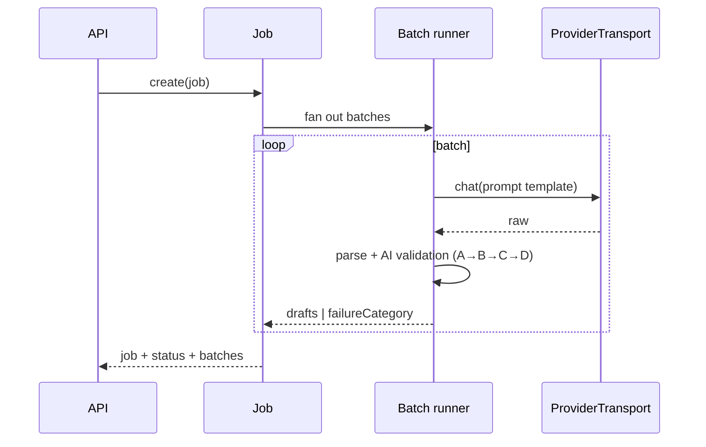

# Generation Jobs

Canonical source for the question-generation job lifecycle and execution model. The AI-output
pipeline (prompt → parse → validate) is [QUESTION_GENERATION.md](../ai/QUESTION_GENERATION.md); this
file is the **backend job** that runs it.

---

## 1. Job model

A job asks for **N questions for one competency** (FR-G1); the backend splits it into **batches**
because a single provider call producing N question-entities reliably is fragile. Batches map
call → drafts:

Layer order (A parse → B shape → C V-01..V-12 → D lifecycle) is [AI_VALIDATION.md](../ai/AI_VALIDATION.md) §1.

## 2. Status model

| status | meaning |
|---|---|
| `queued` | created, not started |
| `running` | some batches in flight |
| `cancelling` | cancel requested, in-flight batches to finish or abort safely |
| `completed` | every batch resolved (drafts or failureCategory) |
| `failed` | job-level failure (no batch could run) |

- `POST /generation-jobs/:id/cancel` only affects **unsubmitted** batches (FR-G2); a result already
  written is not undone.
- A batch carries `failureCategory` from [QUESTION_GENERATION](../ai/QUESTION_GENERATION.md) §5; the
  job aggregates counts.

## 3. Output routing

- Drafts arrive at lifecycle `draft` with provenance-on-arrival (BR-Q1); they are **never** `active`
  until the review screen accepts them (FR-G4, [QUESTION_SPECIFICATION](../examination/QUESTION_SPECIFICATION.md) §3).
- Regeneration is a new job referencing the original, tagged with its own provenance.

## 4. Open items (carried to `BACKEND_TEMP.md`)

- Persistence shape: separate `generation_job`/`generation_batch` tables vs a JSON job-row — not yet
  locked ([DATABASE_SCHEMA](./DATABASE_SCHEMA.md) §2, [DEVELOPMENT_ROADMAP](../roadmap/DEVELOPMENT_ROADMAP.md)).
- Whether in-flight jobs survive a backend restart (crash-recovery semantics).