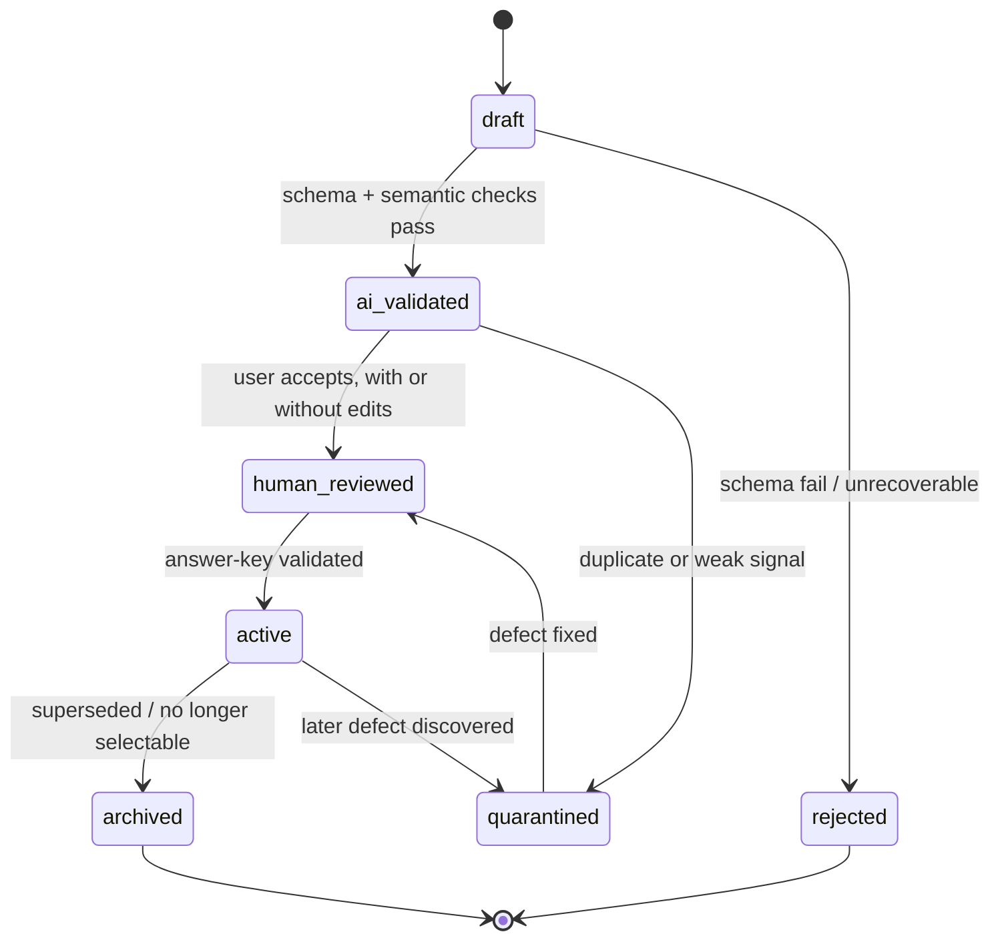

# Question Specification

Canonical source for the **question data model**, its provenance, its lifecycle, and the validation
each question must survive. Scoring weights are defined in
[SCORING_METHODOLOGY.md](./SCORING_METHODOLOGY.md); competency IDs in
[COMPETENCY_TAXONOMY.md](./COMPETENCY_TAXONOMY.md).

---

## 1. Question record

```ts
type Question = {
  id: string;
  configId: string;              // exam config this question was authored against
  test: 'TWK' | 'TIU' | 'TKP';
  competencyId: string;          // leaf node, e.g. "TIU.NUMERIK.DERET"
  difficulty: 'easy' | 'medium' | 'hard';
  stem: string;                  // Indonesian text
  asset?: { ref: string; kind: 'image' | 'table'; alt: string };   // figural / data questions
  options: Array<{ key: 'A'|'B'|'C'|'D'|'E'; text: string }>;
  answerKey: AnswerKey;          // shape from SCORING_METHODOLOGY.md §2.2
  explanation: string;           // required for all types
  sourceRefs?: string[];         // citations for factual content (TWK especially)
  provenance: Provenance;        // §2
  lifecycle: Lifecycle;          // §3
  review: ReviewHistory;         // §4
  validation?: ValidationRecord; // §5
  language: 'id';
  createdAt: string;
  contentVersion: number;        // bumps on ANY edit; sessions freeze this (§3.1)
  contentHash: string;           // sha256 over stem+options+explanation, for duplicate detection
};
```

---

## 2. Provenance

**Canonical. Do not redefine elsewhere.**

| `provenance.kind` | Meaning | Required fields |
|---|---|---|
| `ai_generated` | Produced by a configured provider, not yet reviewed by the user | `providerId`, `modelId`, `promptTemplateId`, `promptVersion`, `generationId`, `generatedAt` |
| `ai_generated_human_reviewed` | AI draft accepted, edited, or corrected by the user | above, **plus** `reviewedBy`, `reviewedAt` |
| `human_authored` | Written by the user from scratch | `authoredAt` |
| `official_historical` | Faithful transcription of a prior-year official exam item | `sourceUrl`, `sourceDocument`, `sourceYear`, `retrievedAt`, `transcriptionNote` |

```ts
type Provenance = {
  kind: 'ai_generated' | 'ai_generated_human_reviewed' | 'human_authored' | 'official_historical';
  // AI
  providerId?: string; modelId?: string;
  promptTemplateId?: string; promptVersion?: string;
  generationId?: string; generatedAt?: string;
  // human
  authoredAt?: string;
  reviewedBy?: string; reviewedAt?: string;
  // historical
  sourceUrl?: string; sourceDocument?: string; sourceYear?: number;
  retrievedAt?: string; transcriptionNote?: string;
};
```

### 2.1 Absolute prohibition

An `ai_generated` or `ai_generated_human_reviewed` question must **never** be presented as official,
government-issued, or CPNS-authored. Enforced at three layers:

1. **Data** — the field exists; no UI path can set `provenance.kind = 'official_historical'` without
   a source URL and year. Setting it is a distinct user action recorded in `review.history`.
2. **UI copy** — AI-origin questions render a visible badge: *"Latihan AI — bukan soal resmi"*.
   Historical questions render *"Arsip {year} — bukan soal siklus berjalan"*.
3. **Prohibited strings** — the question renderer rejects any stem/explanation containing
   "Soal Resmi", "Soal CPNS/BKN", or an official logo/image reference when `kind` is AI-origin.
   Validated by V-12 (§5).

---

## 3. Lifecycle

States and the only permitted transitions:



| State | Selectable in sessions? | Notes |
|---|---|---|
| `draft` | no | just generated or created |
| `ai_validated` | no | passed automated checks, awaiting user decision |
| `human_reviewed` | no | accepted by user, key not yet validated |
| `active` | yes | fully valid |
| `quarantined` | no | blocked, reason stored |
| `rejected` | no | terminal |
| `archived` | no | retained for history |

Illegal transitions are rejected by the application, not merely discouraged by the UI.

**Activation prerequisites.** A question may enter `active` only if:

- its latest `validation` record has `result === 'pass'` and matches the current `contentHash`;
- `answerKeyValidatedAt` is set;
- for AI origins, `review.reviewedAt` is set and `review.acceptedBy === 'user'`.

---

## 4. Review history

```ts
type ReviewHistory = {
  reviewer: string;              // local user identity
  reviewedAt: string;
  decision: 'accepted' | 'edited' | 'rejected';
  edits?: Array<{ field: string; beforeHash: string; afterHash: string }>;
  answerKeyValidatedBy?: string;
  answerKeyValidatedAt?: string;
  notes?: string;
};
```

Review is append-only. Each decision is an entry; nothing is overwritten. The effect of accepting
an AI draft is a **new entry plus** a provenance transition from `ai_generated` to
`ai_generated_human_reviewed` — the original generation metadata is never removed, so the record
still proves the question was AI-produced.

Answer-key validation is separate from content review: a user may accept content and later validate
the key, or vice versa. Both timestamps appear on the record and on the Question Bank UI.

---

## 5. Validation

| ID | Check | Severity | Blocks activation |
|---|---|---|---|
| V-01 | Schema: required fields present, types correct | critical | yes |
| V-02 | Exactly 5 options A–E, non-empty, unique text | critical | yes |
| V-03 | Stem length within config bounds (e.g. 20–600 chars) | high | yes |
| V-04 | Explanation non-empty and ≥ config minimum length | high | yes |
| V-05 | Competency ID exists and is a non-deprecated leaf | critical | yes |
| V-06 | Answer key shape per `SCORING_METHODOLOGY.md` §6.1 (SC-01…SC-08) | critical | yes |
| V-07 | Explanation mentions the reasoning that justifies the key (heuristic: keyed option's distinctive term appears in explanation) | medium | no (flagged for review) |
| V-08 | Duplicate: `contentHash` matches an existing non-archived question | high | yes |
| V-09 | Near-duplicate: sha256 over the minimum token set (stem with numbers and word order normalised) matches more than 1 existing question | medium | no (quarantine default) |
| V-10 | TKP: explanation states why the highest-weight option is best, and why each lower-weighted option is less appropriate | high | yes |
| V-11 | TWK factual claims: at least one `sourceRefs` entry present | high | yes for TWK |
| V-12 | Prohibited official-claim strings absent for AI provenance | critical | yes |

Validation records:

```ts
type ValidationRecord = {
  contentHash: string;
  result: 'pass' | 'fail' | 'flagged';
  checks: Array<{ id: string; passed: boolean; message?: string }>;
  validatorVersion: string;
  validatedAt: string;
};
```

A record is tied to the hash of what was validated; editing the question invalidates it and bumps
`contentVersion`.

### 5.1 Editing versus sessions already started

An edit never reaches a session in progress. `contentVersion` exists so the scoring snapshot can pin
the exact content that was shown:

- Session start copies `{questionId, contentVersion, contentHash, test, competencyId, optionKeys}`
  and a frozen `AnswerKey` into the session snapshot.
- Editing the question afterwards creates `contentVersion + 1` for **future** selection; the running
  session keeps its pinned version and scores against the frozen key.
- Re-validating after an edit produces a new `ValidationRecord` keyed by the new `contentHash`.
- The scoring guarantees are canonical in `SCORING_METHODOLOGY.md` §7; this file only states that the
  fields the snapshot needs are present and non-null.

---

## 6. Generation metadata and regeneration

Generated content that fails validation is not silently kept. See
[QUESTION_GENERATION.md](../ai/QUESTION_GENERATION.md) for retry, batching, regeneration and failure
taxonomy. From this document's perspective, the only requirement is that every generated
question arrives as `draft` with a complete `provenance` block, and that regenerating creates a
**new** question row whose `provenance.generationId` differs.

---

## 7. Question Bank selection rules

- Sessions select `active` questions only.
- Selection records `contentVersion` and freezes the answer key at session start, so a later edit or
  archive cannot alter a session's score (see `SCORING_METHODOLOGY.md` §7).
- Selection filters: `configId`, `test`, `competencyId` (any level), `difficulty`, `provenance.kind`.
  A UI label distinguishes AI-practice from historical-archive items; mixing them in one session
  is allowed but each question keeps its badge in review.
- Selection never balances on "correctness rate" — that would leak difficulty drift into scoring
  comparisons.
