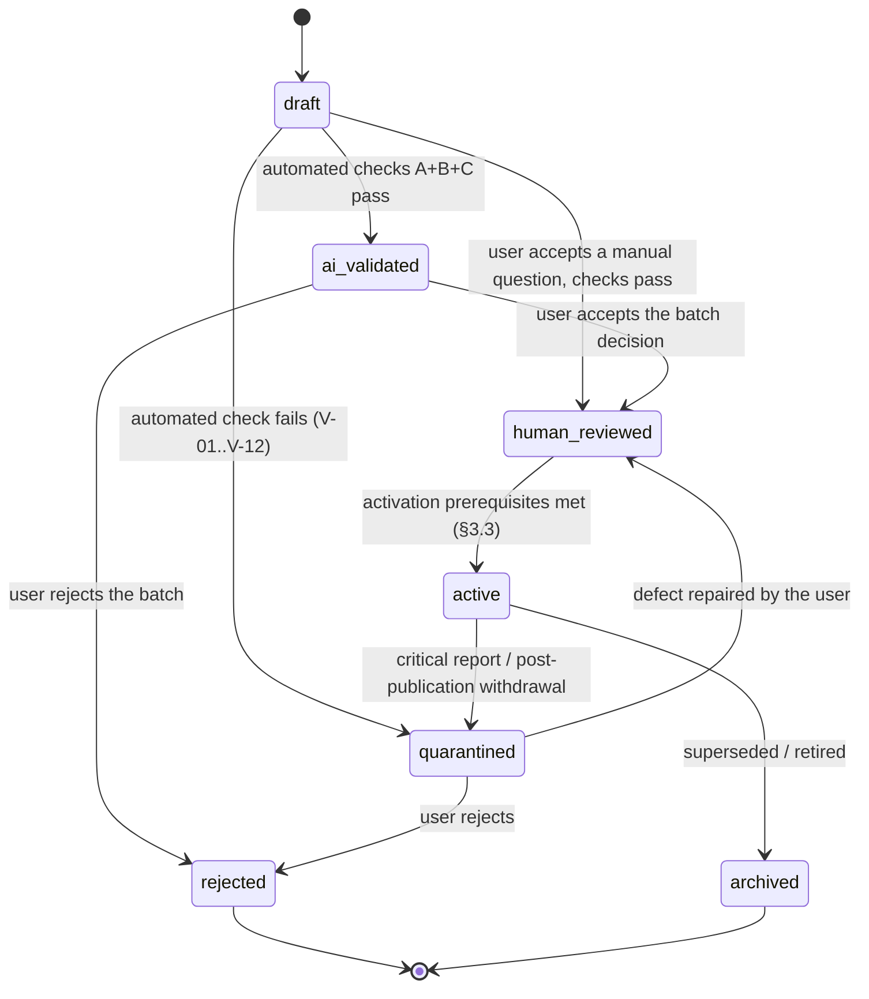

# Question Specification

Canonical source for the **question data model**, its provenance, its lifecycle, its validation and
the **versioning / repair / reporting rules** each question must survive. Scoring weights are defined in
[SCORING_METHODOLOGY.md](./SCORING_METHODOLOGY.md); competency IDs in
[COMPETENCY_TAXONOMY.md](./COMPETENCY_TAXONOMY.md); which questions a session takes in
[PACKAGE_SPECIFICATION.md](../product/PACKAGE_SPECIFICATION.md) §4; materials in
[MATERIAL_SPECIFICATION.md](./MATERIAL_SPECIFICATION.md).

---

## 1. Question record

```ts
type Question = {
  id: string;
  configId: string;              // exam config this question was authored against
  test: 'TWK' | 'TIU' | 'TKP';
  competencyId: string;          // leaf node, e.g. "TIU.NUMERIK.DERET"
  difficulty: Difficulty;        // §1.1 — two separate fields, never merged
  stem: string;                  // Indonesian text
  asset?: { ref: string; kind: 'image' | 'table'; alt: string };   // figural / data questions
  options: Array<{ key: 'A'|'B'|'C'|'D'|'E'; text: string }>;
  answerKey: AnswerKey;          // shape from SCORING_METHODOLOGY.md §2.2
  explanation: string;           // required for all types
  sourceRefs?: string[];         // citations for factual content (TWK especially)
  provenance: Provenance;        // §2
  lifecycle: Lifecycle;          // §3
  dynamicEligible: boolean;      // §6.3 — may this question be dealt by a dynamic package?
  review: ReviewHistory;         // §4 (append-only)
  validation?: ValidationRecord; // §5
  language: 'id';
  createdAt: string;
  contentVersion: number;        // bumps on ANY content edit; sessions freeze this (§7.1)
  contentHash: string;           // sha256 over stem+options+explanation, for duplicate detection
};
```

### 1.1 Difficulty — two fields, two meanings

```ts
type Difficulty = {
  aiInitial: 'easy' | 'medium' | 'hard';    // set at authoring: AI estimate or the user's own choice
  empirical: EmpiricalDifficulty | null;    // derived from answers; null until the sample is sufficient
};

type EmpiricalDifficulty = {
  band: 'easy' | 'medium' | 'hard';
  basis: 'attainment' | 'accuracy';         // TKP uses attainment, TWK/TIU accuracy
  sampleCount: number;                      // answers that contributed
  computedAt: string;
};
```

| Rule | Detail |
|---|---|
| These are **different data fields** with different owners | `aiInitial` is set once at authoring and never rewritten by analytics; `empirical` is written only by the analytics job |
| `empirical = null` until the sample is sufficient | The threshold is owned by [ANALYTICS_ENGINE.md](../backend/ANALYTICS_ENGINE.md) §3.3; the UI must show "belum cukup data", never a guess |
| Selection prefers `empirical` **only when it is non-null** | [PACKAGE_SPECIFICATION.md](../product/PACKAGE_SPECIFICATION.md) §4.2 step 5 |
| Difficulty never enters scoring | It is not a scoring field ([SCORING_METHODOLOGY.md](./SCORING_METHODOLOGY.md) §1) |
| AI may propose `aiInitial` | A provider's difficulty label is a proposal recorded as such; it never becomes `empirical` |

### 1.2 TKP option justifications

A TKP key weights every option ([SCORING_METHODOLOGY.md](./SCORING_METHODOLOGY.md) §3.2), and V-10
(§5.1) already requires the explanation to say why each option earns its weight. The review screen
shows that per-option reasoning, so the reasoning becomes **structured data on the question**, keyed
by the same option keys as `answerKey.optionScores`:

```ts
type AnswerKey = {                          // SCORING_METHODOLOGY.md §2.2
  questionId: string;
  scoringVersion: number;
  optionScores: Record<string, number>;     // "A".."E" -> weight
  /** TKP only; TWK/TIU omit it (V-13). Every key of `optionScores` has one entry here. */
  optionJustifications?: Record<string, string>;
  unansweredScore: number;
  maxScore: number;
};
```

Product Owner decision 2026-11-09 (revision of the Tinjau Jawaban result screen): TKP review must show
each option's value **and why it earns that value**, so the justification is stored beside the weight
it explains rather than buried in the narrative.

| Rule | Detail |
|---|---|
| Identity | `optionJustifications` keys are exactly the `optionScores` keys — the question's frozen option keys. Never a text match, a position, or an option label (V-13) |
| Completeness | Every weighted option has a non-empty justification; a partial map is invalid (V-13, blocks activation) |
| TWK/TIU | The field is absent. A TWK/TIU key carrying `optionJustifications` fails V-13 — one correct answer needs no per-option reasoning, and its key is `optionScores: {keyed: maxScore, others: 0}` ([SCORING_METHODOLOGY.md](./SCORING_METHODOLOGY.md) §3.1) |
| Ties | Weights need not be distinct ([SCORING_METHODOLOGY.md](./SCORING_METHODOLOGY.md) §3.2). **Every** option whose weight equals `maxScore` carries its own justification; there is no single "best option" to single out |
| Versioning | It is part of the answer key: stored with the key, frozen into the session snapshot like every other key field, and **not** part of `contentHash` (which covers stem + options + explanation, §1) |
| Edit policy | Edited only through the key edit path (V-06 protection: refused while a session that froze the key is `open`), recorded in `review` as an edit of field `optionJustifications` |
| Provenance | AI-generated keys propose it ([AI_VALIDATION](../ai/AI_VALIDATION.md) AI-06); a user may rewrite it in the key editor |

**Scope of this rule — shape, not historical data.** §1.2 defines what a key **carries** and V-13
enforces it on a question that is **activated** after this rule exists. It does not assert that keys
frozen before the field was introduced already satisfy it, that such keys have been rewritten, or that
a migration exists. Storage mechanics and compatibility with pre-existing snapshots are
**UNRESOLVED — TECHNICAL DESIGN REQUIRED** ([API_SPECIFICATION](../backend/API_SPECIFICATION.md)
§7.7.1 E78-T2); the review screen handles the absence by field, without inventing reasoning.

**Historical data.** Questions whose key predates this field may have no `optionJustifications`. They
stay **usable** — the weight map is unchanged, they remain valid for scoring, and the review screen still
lists every option and its weight, stating that the per-option reasoning is unavailable
([FRONTEND_RESULTS_ANALYTICS](../frontend/FRONTEND_RESULTS_ANALYTICS.md) §2.2.1.1). **Back-fill is not
required** (Product Owner 2026-11-09) and no automatic migration or back-fill may be created; the
specification does not fill them by assumption, and nothing here claims historical keys satisfy V-13.

**Where the reviewer reads it.** The review screen reads the **frozen** key's reasoning when it has any
(the key is what was scored), and falls back to the **latest** version only for an older key without it.
The explanation is shown **only when the question's latest version equals the version the session froze**
(strict version matching, Product Owner 2026-11-09); otherwise the block says the explanation is not
available and shows nothing from another version
([FRONTEND_RESULTS_ANALYTICS](../frontend/FRONTEND_RESULTS_ANALYTICS.md) §2.2.3). How the version
identity is proven is a technical-design question ([API_SPECIFICATION](../backend/API_SPECIFICATION.md)
§7.7.1 E78-T4).

---

## 2. Provenance

**Canonical. Do not redefine elsewhere.**

| `provenance.kind` | Meaning | Required fields |
|---|---|---|
| `ai_generated` | Produced by a configured provider, not yet accepted by the user | `providerId`, `modelId`, `promptTemplateId`, `promptVersion`, `generationId`, `batchId`, `generatedAt` |
| `ai_generated_human_reviewed` | AI draft accepted, edited, or corrected by the user | above, **plus** `reviewedBy`, `reviewedAt` |
| `human_authored` | Written by the user in the one-by-one form | `authoredAt` |
| `official_historical` | Faithful transcription of a prior-year official exam item | `sourceUrl`, `sourceDocument`, `sourceYear`, `retrievedAt`, `transcriptionNote` |

```ts
type Provenance = {
  kind: 'ai_generated' | 'ai_generated_human_reviewed' | 'human_authored' | 'official_historical';
  regeneratesQuestionId?: string;   // set when this row regenerates an earlier one (§6.4)
  // AI
  providerId?: string; modelId?: string;
  promptTemplateId?: string; promptVersion?: string;
  generationId?: string; batchId?: string; generatedAt?: string;
  // human
  authoredAt?: string;
  reviewedBy?: string; reviewedAt?: string;
  // historical
  sourceUrl?: string; sourceDocument?: string; sourceYear?: number;
  retrievedAt?: string; transcriptionNote?: string;
  // quality gate state (§6.3)
  sampling?: SamplingRecord;
};

/** Which checks ran on this question's current content, and with what outcome. */
type SamplingRecord = {
  required: boolean;             // false for human_authored and official_historical (§6.1)
  status: 'pending' | 'sampled_pass' | 'sampled_findings' | 'not_applicable';
  batchId?: string;
  sampleSize?: number;           // questions drawn for review
  findingsCount?: number;
  decidedAt?: string;
};
```

### 2.1 Absolute prohibition

An `ai_generated` or `ai_generated_human_reviewed` question must **never** be presented as official,
government-issued, or CPNS-authored. Enforced at three layers:

1. **Data** — the field exists; no UI path can set `provenance.kind = 'official_historical'` without
   a source URL and year. Setting it is a distinct user action recorded in `review.history`.
2. **UI copy** — AI-origin questions render a visible badge: *"Latihan AI — bukan soal resmi"*.
   Historical questions render *"Arsip {year} — bukan soal siklus berjalan"*.
3. **Prohibited strings** — the question renderer rejects any stem/explanation containing
   "Soal Resmi", "Soal CPNS/BKN", or an official logo/image reference when `kind` is AI-origin.
   Validated by V-12 (§5).

This applies to the **explanation** too, including a TKP explanation of option weights (§5 V-10).

---

## 3. Lifecycle

### 3.1 States

```ts
// The seven states; nothing else is a lifecycle value.
type Lifecycle =
  | 'draft' | 'ai_validated' | 'human_reviewed' | 'active'
  | 'quarantined' | 'rejected' | 'archived';
```

| State | Selectable in sessions? | Notes |
|---|---|---|
| `draft` | no | just generated or created |
| `ai_validated` | no | passed automated checks (§5), awaiting the batch decision |
| `human_reviewed` | no | accepted by the user; key not yet validated |
| `active` | **yes, when `dynamicEligible`** | fully valid and its quality gate is satisfied (§6.3) |
| `quarantined` | no | blocked; reason stored |
| `rejected` | no | terminal |
| `archived` | no | retained for history |

`active` is necessary but **not sufficient** for selection: a question whose batch is still awaiting
sampling is `active` with `dynamicEligible = false`
([PACKAGE_SPECIFICATION.md](../product/PACKAGE_SPECIFICATION.md) §4.1).

### 3.2 Transitions



Edges that do **not** exist:

- no `draft → active` and no `ai_validated → active` — acceptance is always an explicit user act;
- no `quarantined → active` — a repaired question returns to `human_reviewed` and must satisfy the
  activation prerequisites **again**, including re-sampling when it came from an AI batch (§6.5);
- no automatic `active → archived` when a repair supersedes a version: the old version stays `active`
  only if it is still correct; otherwise it is `quarantined` (wrong content) or `archived` (superseded
  by an equivalent but improved version).

Illegal transitions are rejected by the application, not merely discouraged by the UI.

**Bulk operation.** The only bulk transition is `active → archived`, one transaction
(`POST /questions/bulk`, [API_ENDPOINTS](../backend/API_ENDPOINTS.md) §6, FR-Q4; Product Owner, 2026-11-09,
[AUDIT](../AUDIT.md) AUD-74). Every submitted `questionId` is validated against this section and FR-Q4;
an id that is not `active` or does not exist rejects the whole call. It offers no bulk activate, no bulk
accept and no bulk edit; every other edge is applied one question at a time.

### 3.3 Activation prerequisites

A question may enter `active` only if **all** hold:

- its latest `validation` record has `result === 'pass'` and matches the current `contentHash`;
- `answerKeyValidatedAt` is set;
- for AI origins, `review.reviewedAt` is set and `review.acceptedBy === 'user'`;
- `provenance.sampling.status` is `sampled_pass`, or the question is `human_authored` /
  `official_historical` with `sampling.status = 'not_applicable'` (§6.1).

---

## 4. Review history

```ts
type ReviewHistory = {
  reviewer: string;              // local user identity
  reviewedAt: string;
  decision: 'accepted' | 'edited' | 'rejected' | 'reported' | 'repaired' | 'withdrawn';
  activity: 'content' | 'batch_decision' | 'sample_review' | 'report_triage' | 'repair';
  edits?: Array<{ field: string; beforeHash: string; afterHash: string }>;
  answerKeyValidatedBy?: string;
  answerKeyValidatedAt?: string;
  notes?: string;
};

type ReviewEntry = ReviewHistory;   // appended, never mutated
```

Review is append-only. Each decision is an entry; nothing is overwritten. The effect of accepting
an AI draft is a **new entry plus** a provenance transition from `ai_generated` to
`ai_generated_human_reviewed` — the original generation metadata is never removed, so the record
still proves the question was AI-produced.

`activity` makes the **provenance record complete**: the history shows whether a question was
individually reviewed, accepted as part of a sampled batch, or repaired after a report (§6).

Answer-key validation is separate from content review: a user may accept content and later validate
the key, or vice versa. Both timestamps appear on the record and on the Question Bank UI.

---

## 5. Validation

Validation is layered. The **layer order is canonical** and is applied identically to manual and AI
questions:

| Layer | Name | Scope | Canonical home |
|---|---|---|---|
| **T** | Technical / structural | parse, shape, V-01…V-12 | this section (AI parse/shape: [AI_VALIDATION](../ai/AI_VALIDATION.md)) |
| **Q** | AI quality rating | the model rates its own output against the competency and difficulty target | §6.2 |
| **K** | Consistency check | competency match, difficulty plausibility, duplicate/conflict with the bank | §6.2 |
| **S** | User sampling | a sample of the batch is read by the user | §6.3 |

Layer **T** fails → the question is **quarantined** automatically and the batch reports the failure
(§6.2). Layer **Q** or **K** failing → the question is quarantined with the failing layer named; it is
not deleted, so it can be repaired.

### 5.1 Technical checks

| ID | Check | Severity | Blocks activation |
|---|---|---|---|
| V-01 | Schema: required fields present, types correct | critical | yes |
| V-02 | Exactly 5 options A–E, non-empty, unique text | critical | yes |
| V-03 | Stem length within config bounds (e.g. 20–600 chars) | high | yes |
| V-04 | Explanation non-empty and ≥ config minimum length | high | yes |
| V-05 | Competency ID exists and is a non-deprecated leaf | critical | yes |
| V-06 | Answer key shape per `SCORING_METHODOLOGY.md` §6.1 (SC-01…SC-08) | critical | yes |
| V-07 | Explanation mentions the reasoning that justifies the key (heuristic: keyed option's distinctive term appears in explanation) | medium | no (flagged for review) |
| V-08 | Duplicate: `contentHash` matches an existing non-archived question | high | yes |
| V-09 | Near-duplicate: sha256 over the minimum token set (stem with numbers and word order normalised) matches more than 1 existing question | medium | no (quarantine default) |
| V-10 | TKP: explanation states why the highest-weight option is best, **and why each lower-weighted option is less appropriate** | high | yes |
| V-11 | TWK factual claims: at least one `sourceRefs` entry present | high | yes for TWK |
| V-12 | Prohibited official-claim strings absent for AI provenance | critical | yes |
| V-13 | §1.2 option justifications: a TKP key carries `optionJustifications` whose keys are exactly the `optionScores` keys, each a non-empty string; a TWK/TIU key carries none | high | yes |

V-10 is the technical half of the "explain every option's weight" decision: a TKP explanation that
discusses only the top option fails. The **rendering** half (each option's points shown to the learner
after an answer in Latihan) is [FRONTEND_EXAM_FLOW.md](../frontend/FRONTEND_EXAM_FLOW.md) §9.

Validation records:

```ts
type ValidationRecord = {
  contentVersion: number;
  contentHash: string;
  layers: {                            // one entry per layer that ran
    layer: 'T' | 'Q' | 'K';
    result: 'pass' | 'fail' | 'flagged';
    checks: Array<{ id: string; passed: boolean; message?: string }>;
  }[];
  result: 'pass' | 'fail' | 'flagged'; // aggregate: fail if any layer failed
  validatorVersion: string;
  validatedAt: string;
};
```

A record is tied to the hash of what was validated; editing the question invalidates it and bumps
`contentVersion`. Layer `Q` and `K` are **AI-assisted checks**: their output is a signal recorded in the
record, never an approval.

---

## 6. Quality gate: batches, sampling, repair, withdrawal

### 6.1 Manual questions

- A manual question is created one at a time in a form
  ([FRONTEND_PAGE_SPECIFICATIONS.md](../frontend/FRONTEND_PAGE_SPECIFICATIONS.md) §Kelola).
- It runs layer **T** only. There is no batch and therefore **no sampling**
  (`sampling.status = 'not_applicable'`).
- Passing T, and after the user's own review and key validation, it becomes `active` with
  `dynamicEligible = true`.
- **No CSV/Excel import and no bulk editing in MVP.** Bulk create would bypass the per-question form and
  the per-question validation; bulk edit would silently invalidate validated content. Both are recorded
  as non-goals ([MVP_SCOPE.md](../product/MVP_SCOPE.md) §3).

### 6.2 AI batch flow

```
Request (competency set, difficulty, count, config)
  → job (backend, batched)                         [GENERATION_JOBS.md](../backend/GENERATION_JOBS.md)
  → per question: T (parse, shape, V-01..V-12)
        pass → Q (AI quality rating) → K (consistency)
        fail → quarantined (reason stored; raw response kept)
  → batch summary: passedForSampling | quarantined
  → user reviews a SAMPLE of passedForSampling   (layer S)
        sample clean  → all passedForSampling questions become active + dynamicEligible
        findings      → only the named questions are quarantined for repair; the rest are eligible
  → notification: batch_awaiting_sampling          [NOTIFICATION_SPECIFICATION.md](../backend/NOTIFICATION_SPECIFICATION.md)
```

Rules:

1. **Everything is auto-validated.** No question reaches sampling without passing T.
2. **Failures are quarantined, not discarded.** A quarantined question keeps its content, its raw
   provider response and the failing check so the user can repair it.
3. **The user reviews a sample, not the whole batch.** Sampling catches systematic faults without asking
   the user to read everything. **The quota itself is an unresolved product parameter** — it has not been
   approved, so no number is fixed here and none is assumed in its place (report §8 Q-4). The contract
   carries `sampleSize` and the sample the backend drew; the UI states that size and never derives it.
   Until the quota is approved, the backend may block a batch from being marked `sampled_pass` and say so,
   but it does not invent a threshold.
4. **A sample finding is scoped.** Only questions the finding names are quarantined; the rest of the batch
   stays eligible. A finding that is **systemic** (a stated pattern: same competency mismatch, same
   answer-key error, same prompt defect) quarantines the batch and is stated as such.
5. **Good questions are never discarded because of a neighbour.** This is why the gate is per question.

### 6.3 Sampling outcome and `dynamicEligible`

`dynamicEligible = true` requires: `lifecycle = 'active'` **and** the quality gate satisfied:

| Origin | Gate satisfied when |
|---|---|
| `human_authored` | T passed, key validated, user accepted |
| `official_historical` | T passed, source recorded |
| AI batch, sample clean | `sampling.status = 'sampled_pass'` |
| AI batch, repaired question | re-validation passed **and** re-sampled (`sampled_pass`) |
| AI batch, sampling pending | **false** — the question is not dealt by a dynamic package yet |

A question with `dynamicEligible = false` may still be read in the bank and reviewed; it is not
selectable for a session by a dynamic package
([PACKAGE_SPECIFICATION.md](../product/PACKAGE_SPECIFICATION.md) §4.1).

### 6.4 Repair and replacement

- **Selective repair.** On a sampling finding the user may edit the named question(s). Any edit bumps
  `contentVersion`, invalidates the validation record and sets `sampling.status = 'pending'`.
- **Replacement.** A repaired question or a replaced draft is re-validated through **T → Q → K** and then
  **re-sampled** before it can become `dynamicEligible`. A replacement is a **new content version** of
  the same question, or — when `provenance.regeneratesQuestionId` is used — a new row; either way the old
  version and its history are retained.
- No repair path sets `active` directly (§3.2).

### 6.5 Sampling is not a guarantee

The app states this in the UI whenever it reports quality: **"Sampel sudah diperiksa, bukan jaminan
seluruh soal benar."** The mechanisms that back the statement:

1. **User reporting** — any question can be reported from a session, result or the bank
   (`POST /questions/:id/reports`).
2. **Critical reports auto-quarantine** — a report classed `critical` (`wrong_key`, `ambiguous`) moves
   the question to `quarantined` immediately and raises a notification. The classification is the
   reporting user's choice from a closed set; the app does not infer it.
3. **Non-critical reports queue for review** — stored, listed in **Kelola → Review Soal**, no state change.
4. **The final decision stays with the user** — the app never restores a question on its own, and never
   withdraws one permanently on its own. The only automatic action is the temporary quarantine in (2).
5. **Post-publication withdrawal** — a user may withdraw an `active` question at any time
   (`active → quarantined`, reason stored). It leaves the pool for future sessions at once.
6. **Repaired questions return only after the required validation** (§6.4).

`SamplingRecord.status = 'sampled_findings'` stays on the record after repair, so the history shows that
the batch produced findings.

### 6.6 Active sessions are never changed

A question edit, quarantine or withdrawal **never** reaches a session that already started:
the session froze the question's content version, hash and answer key at creation (§7.1). A withdrawn
question stays in the frozen roster and is scored from the frozen content; the result screen shows no
"question withdrawn" state, because the session was valid when it ran.

---

## 7. Versions and frozen sessions

### 7.1 Editing versus sessions already started

An edit never reaches a session in progress. `contentVersion` exists so the scoring snapshot can pin
the exact content that was shown:

- Session start copies `{questionId, contentVersion, contentHash, test, competencyId, optionKeys}`
  and a frozen `AnswerKey` into the session snapshot.
- Editing the question afterwards creates `contentVersion + 1` for **future** selection; the running
  session keeps its pinned version and scores against the frozen key.
- Re-validating after an edit produces a new `ValidationRecord` keyed by the new `contentHash`.
- The scoring guarantees are canonical in `SCORING_METHODOLOGY.md` §7; this file only states that the
  fields the snapshot needs are present and non-null.

### 7.2 Revision history retention

- Every content version is retained with its validation record, its review entries and the edits that
  produced it. Nothing is overwritten; nothing is deleted when a new version appears.
- The bank detail screen shows the version list and, for each, the session(s) that used it.
- **Which version a session used** is readable from the session snapshot and from the bank detail
  ("dipakai di sesi …"), so a past result can always be traced to the exact wording that was scored.

---

## 8. Question Bank

### 8.1 List filters

| Filter | Values |
|---|---|
| Search text | substring over stem (and explanation when toggled) |
| Subtest | `TWK` / `TIU` / `TKP` |
| Submateri | a taxonomy leaf, or a domain roll-up |
| Difficulty | `aiInitial` band; `empirical` band as a separate filter |
| Status | `lifecycle` value |
| Origin | `provenance.kind` |
| Provider / model | provider id + model id |
| Batch | `provenance.batchId` |
| Creation date | from / to |

- **No saved filters in MVP.** A filter set lives in the URL/query state only; it is not persisted as a
  named view. Recorded as a non-goal ([MVP_SCOPE.md](../product/MVP_SCOPE.md) §3).
- Filters are **server-side** (the list is paginated) and return counts per facet so the UI can state
  why a filter produced an empty list.

### 8.2 Selection rules

- Sessions select `active` questions with `dynamicEligible = true`
  ([PACKAGE_SPECIFICATION.md](../product/PACKAGE_SPECIFICATION.md) §4.1).
- Selection records `contentVersion` and freezes the answer key at session start, so a later edit or
  archive cannot alter a session's score (§7.1).
- Selection filters: `configId`, `test`, `competencyId` (any level), `difficulty`, `provenance.kind`.
  A UI label distinguishes AI-practice from historical-archive items; mixing them in one session
  is allowed but each question keeps its badge in review.
- Selection never balances on "correctness rate" — that would leak difficulty drift into scoring
  comparisons.
- **Repeat handling is owned by** [PACKAGE_SPECIFICATION.md](../product/PACKAGE_SPECIFICATION.md) §4.2:
  previously answered questions are avoided while unseen stock suffices, and the repeat count is
  computed server-side and warned about before a tryout starts.

---

## 9. Generation metadata and regeneration

Generated content that fails validation is not silently kept. See
[QUESTION_GENERATION.md](../ai/QUESTION_GENERATION.md) for retry, batching, regeneration and failure
taxonomy. From this document's perspective, the only requirement is that every generated
question arrives as `draft` with a complete `provenance` block, and that regenerating creates a
**new** question row whose `provenance.generationId` differs and whose
`provenance.regeneratesQuestionId` names the original. The two are never merged into one row.

A regenerated or repaired question re-enters the gate at layer **T** (§6.4) and cannot skip sampling.
