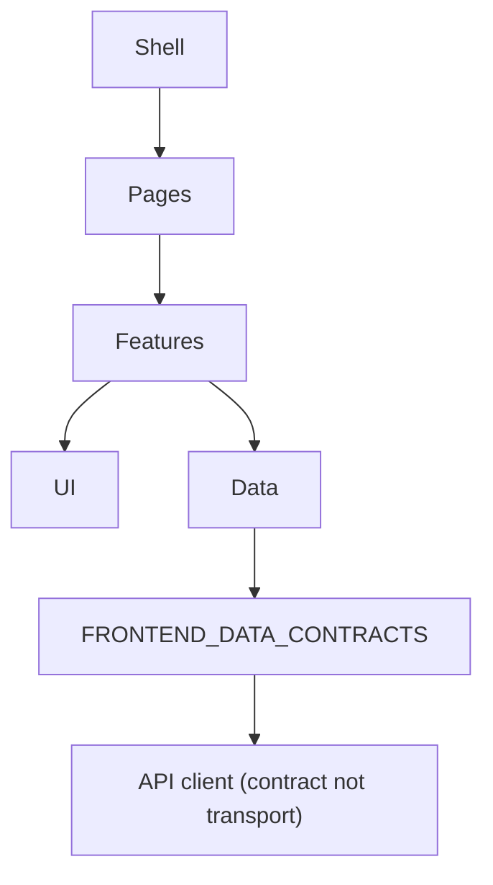

# Frontend Component Architecture

Component decomposition. Stack is the **candidate** React + TS + Vite + Tailwind
([ARCHITECTURE_DECISIONS](../architecture/ARCHITECTURE_DECISIONS.md) ADR-010), so this is expressed
in that idiom but holds for any component framework.

---

## 1. Layers

- **UI** — presentational primitives, no domain logic, no data fetching.
- **Features** — one folder per feature area; owns its screen state and orchestration.
- **Data** — the single client that maps API envelopes to contract types; the only place that parses
  server JSON (never scattered across components).
- **Pages/Shell** — routing + layout only.

## 2. UI primitives (shared, small set)

`Badge` (state semantics) · `Card` · `Button` · `Dialog` · `MetricStat` (number + counts) ·
`Table` · `Progress` · `QuestionRunner` (shared tryout/practice layout, FR-P3) ·
`OptionsList` (TKP-aware: no "correct" affordance).

No UI primitive encodes scoring rules; `QuestionRunner` only renders an
`AnswerKey`-shaped contract for disclosure timing and understands TWK/TIU-vs-TKP **display**, not
computation.

## 3. Feature modules

| Feature | Key components | Owns |
|---|---|---|
| dashboard | `DashboardPage`, `WeaknessCard`, `RecentSessions` | read-only renders |
| tryout | `TryoutStart`, `Runner`, `ResultPage` | session submit flow |
| practice | `PracticeStart`, reusing `Runner` | drill config |
| bank | `QuestionList`, `QuestionDetail`, `BulkToolbar` | lifecycle actions |
| generation | `GenerationSetup`, `ReviewScreen`, `BatchProgress` | job polling + review |
| analytics | `AnalyticsPage`, `TrendChart`, `DifficultyGrid` | render `AnalyticsSnapshot` |
| ai-config | `ProviderList`, `ProviderForm`, `TaskMap` | masked-key display |
| exam-config | `ConfigDetail`, `ApprovalDialog` | approval UX |
| study-plan | `StudyPlanEditor` | propose-diff editing |

## 4. State location (simple-first)

- **Local component state** for screen-local UI (open dialog, selected tab).
- **A small client store** (not a heavy state library) for cross-screen session data (active runner,
  current config) — see [FRONTEND_STATE_MANAGEMENT.md](./FRONTEND_STATE_MANAGEMENT.md).
- **No premature Zustand/Redux/TanStack Query** (plan constraint); a `fetch` wrapper + module store
  is the baseline, upgraded only if a concrete need appears
  ([FRONTEND_IMPLEMENTATION_PLAN](./FRONTEND_IMPLEMENTATION_PLAN.md) §4).

## 5. Boundaries

- Every component prop/state type comes from [FRONTEND_DATA_CONTRACTS.md](./FRONTEND_DATA_CONTRACTS.md),
  not invented inline.
- Responding to `PREFLIGHT_FAILED`/`APPROVAL_INVALID`/`THRESHOLD_CONFIG_INVALID` is centralised in
  the Data layer's error mapper — components receive a typed result, never a raw body.
- Accessibility lives in every UI primitive, verified per [FRONTEND_ACCESSIBILITY.md](./FRONTEND_ACCESSIBILITY.md).