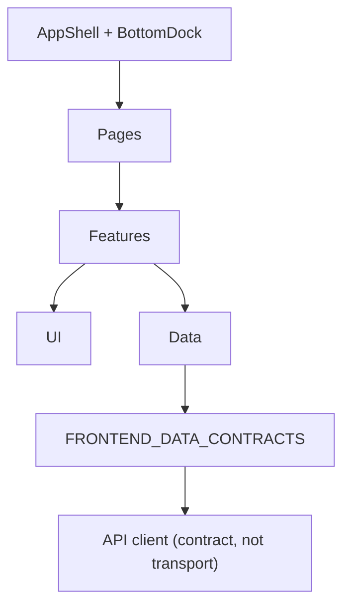

# Frontend Component Architecture

Component decomposition. Stack is the **candidate** React + TS + Vite + Tailwind (ADR-010, Proposed),
so this is expressed in that idiom but holds for any component framework.

---

## 1. Layers

- **UI** — presentational primitives, no domain logic, no fetching.
- **Features** — one folder per screen group; owns screen state and orchestration.
- **Data** — the only place server JSON is parsed; maps envelopes and errors to typed results.
- **Pages / Shell** — routing + layout only.

## 2. UI primitives (small shared set)

| Primitive | Purpose |
|---|---|
| `BottomDock` | five-item navigation, phone + desktop |
| `Button` | primary / secondary / danger; disabled state carries its reason |
| `Card` | rounded surface; the default container |
| `Badge` | provenance badge, material-status badge, sample-status badge — **never a config badge in Belajar** |
| `NumberStat` | integer with its raw counts beside it (`72% (18/25)`) |
| `Dialog` | confirmations; focus-trapped |
| `ProgressBar` | generation batches, submit in-flight |
| `QuestionView` | stem, optional asset, options — **display only** |
| `OptionsList` | choice list; TWK/TIU single-select, TKP weighted-choice with no "correct" affordance |
| `Runner` | shared layout for tryout and Latihan (FR-P3) |
| `Clock` | renders server-confirmed `activeMs` / `durationMs`; shows a paused state; never counts locally |
| `Notice` | `ExamConfig.notice`, `Belum Terverifikasi` note, no-verdict sentence |
| `ReviewBlock` | one Tinjau jawaban question: identity → stem → answer → status → key → Pembahasan. Renders `ReviewQuestion` verbatim; `keyedOption` is read, never derived; TKP table comes from `optionScores` + `optionJustifications` |
| `Pager` | "3 / 4" with Sebelumnya/Berikutnya; five items per page on Tinjau jawaban |
| `NotificationBell` | shell surface with unread count and text alternative |

No primitive encodes a scoring rule. `Runner` composes `QuestionView` + `OptionsList` + navigation
and dispatches by `mode`; it never computes a score. For the same reason `ReviewBlock` receives the
keyed option, the weights and the points from the response — it never compares the selected key with
an option's weight (FRONTEND_RESULTS_ANALYTICS §2.2.1).

## 3. Feature modules

| Feature | Key screens | Owns |
|---|---|---|
| beranda | `BerandaPage` | bootstrap read, resume/open-session choice, learner pending actions |
| tryout | `PackageList`, `PackageDetail`, `TryoutRunner`, `SubmitConfirm`, `TryoutResult`, `AnswerReview` | session create → autosave → submit → result; `AnswerReview` composes `ReviewBlock` × ≤5 over one E78 page request |
| latihan | `LatihanPick`, `LatihanRunner`, `LatihanSummary` | submateri drill, inline feedback |
| progres | `ProgresPage`, `CompetencyDetail`, `StudyPlan` | renders `AnalyticsSnapshot` verbatim |
| lainnya | `LainnyaPage` | navigation index |
| soal | `QuestionList`, `QuestionDetail`, `QuestionForm` | lifecycle actions, filters, manual create |
| review | `ReviewQueue`, `SamplingScreen`, `ReportQueue` | sampling outcome, report triage |
| materi | `MaterialList`, `MaterialDetail` | versions, sources, approval |
| generasi | `GenerateSetup`, `JobProgress` | job polling, retry |
| ai | `ProviderList`, `ProviderForm`, `RoutingForm` | masked key display, default + overrides |
| ujian | `ConfigList`, `ConfigDetail`, `ApprovalDialog` | approval UX |
| paket | `PackageAdminList`, `PackageAdminDetail` | custom packages, versions |
| pengaturan | `BackupSettings`, `RestoreWizard` | folder, retention, restore |

## 4. State location

- Screen-local UI state in the component.
- One small module store for the few cross-screen values
  ([FRONTEND_STATE_MANAGEMENT](./FRONTEND_STATE_MANAGEMENT.md) §2).
- No Zustand/Redux/TanStack Query until a documented trigger appears
  ([FRONTEND_STATE_MANAGEMENT](./FRONTEND_STATE_MANAGEMENT.md) §4).

## 5. Boundaries

- Every prop/state type comes from [FRONTEND_DATA_CONTRACTS](./FRONTEND_DATA_CONTRACTS.md); nothing is
  typed inline against a raw shape.
- `PREFLIGHT_FAILED`, `CONTRACT_MISMATCH`, `PROVIDER_*` are handled once in the error mapper; screens
  receive a typed result. A withheld verdict is **not** an error path — it is a `ScoreResult` with
  `verdict: null`.
- Accessibility is a property of each primitive, verified per
  [FRONTEND_ACCESSIBILITY](./FRONTEND_ACCESSIBILITY.md).
