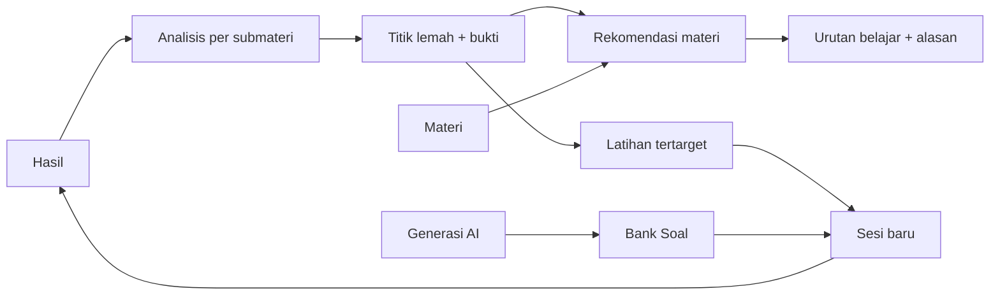

# Product Requirements Document — TryoutSim

Status: planning baseline · Date: 2026-11-07 · revised 2026-11-08 (CPNS-only scope, two-area navigation,
packages, drill flows, question lifecycle, jobs, backup/security) · Owner: user (Sakbanullah)

Canonical sources referenced here, never restated: exam rules [CPNS_2026_REGULATIONS.md](../examination/CPNS_2026_REGULATIONS.md) ·
competency ids [COMPETENCY_TAXONOMY.md](../examination/COMPETENCY_TAXONOMY.md) ·
scoring [SCORING_METHODOLOGY.md](../examination/SCORING_METHODOLOGY.md) ·
question model [QUESTION_SPECIFICATION.md](../examination/QUESTION_SPECIFICATION.md) ·
packages and session assembly [PACKAGE_SPECIFICATION.md](./PACKAGE_SPECIFICATION.md) ·
materials [MATERIAL_SPECIFICATION.md](../examination/MATERIAL_SPECIFICATION.md) ·
AI provider layer [AI_PROVIDER_ARCHITECTURE.md](../ai/AI_PROVIDER_ARCHITECTURE.md) ·
navigation [FRONTEND_INFORMATION_ARCHITECTURE.md](../frontend/FRONTEND_INFORMATION_ARCHITECTURE.md) ·
deployment and backup [DEPLOYMENT_AND_BACKUP.md](../architecture/DEPLOYMENT_AND_BACKUP.md).

---

## 1. Product vision

A private, local-first drill room for the Indonesian CPNS academic selection. The user studies on
their own machine, with their own AI provider, and the app keeps an honest record of what they know
and what they don't.

## 2. Problem

CPNS preparation material is plentiful but untrustworthy: questions are recycled, explanations are
shallow, "official" labels are applied loosely, and performance feedback is a score without a next
step. The learner does not know *which competency* is costing marks, or whether a result is a real
pattern or one lucky session.

## 3. Objectives

| ID | Objective | Measure |
|---|---|---|
| O-1 | Honest content labelling | 0 UI surfaces present AI questions as official; every question carries provenance |
| O-2 | Diagnose, not just grade | Every session produces per-submateri evidence with sample size |
| O-3 | Close the loop | Every identified weakness leads to a recommended material and a targeted drill |
| O-4 | Measure improvement | Trend per competency over ≥ 3 comparable sessions shows direction with a stated caveat |
| O-5 | Provider independence | Switching provider/model requires no change to examination, analytics or recommendation logic |
| O-6 | Local and private | Runs with no cloud account; API keys never reach the browser |
| O-7 | Works without a verified instrument | Sessions, scoring and analysis run on a clearly labelled temporary config; no verdict is fabricated |

## 4. Scope — CPNS only

**The product serves the CPNS SKD pathway only.** No screen, package, selector, report, prompt or
document offers another recruitment pathway. Rules from a different pathway are never cited as CPNS
authority ([CPNS_2026_REGULATIONS.md](../examination/CPNS_2026_REGULATIONS.md) §8, BR-E1).

Historical records from before this scope decision are **retained, not deleted** (§11); they are
readable for evidence and replay and are never offered in the learner area.

## 5. Concept and language (Indonesian-first)

| Product term | Indonesian UI |
|---|---|
| Try Out | **Tryout** |
| Practice | **Latihan** |
| Question bank | **Bank Soal** |
| Session | **Sesi** |
| Attempt / result | **Hasil** |
| Competency / sub-competency | **Kompetensi / Submateri** |
| Weakness | **Titik Lemah** |
| Study plan | **Rencana Belajar** — *not in MVP*; do not use the term as a screen name |
| Learning sequence | **Urutan Belajar** |
| Learning material | **Materi** |
| AI practice badge | **Latihan AI — bukan soal resmi** |
| Historical archive badge | **Arsip {tahun} — bukan soal siklus berjalan** |
| Unverified exam config | **Belum Terverifikasi** |

## 6. Navigation — two areas

The product has **two areas**, and every screen belongs to exactly one. Canonical definition:
[FRONTEND_INFORMATION_ARCHITECTURE.md](../frontend/FRONTEND_INFORMATION_ARCHITECTURE.md) §4.

| Area | Reached by | Contains |
|---|---|---|
| **Belajar** | main navigation | **Beranda**, **Tryout**, **Latihan**, **Progres** |
| **Kelola** | main navigation → **Lainnya** | **Bank Soal**, **Review Soal**, **Materi**, **Generasi AI**, **Pengaturan AI**, **Konfigurasi Ujian**, **Manajemen Paket** |

Rules:

- **Belajar is the learner path.** It never asks the learner to choose or inspect an exam config, a
  package version or a scoring rule.
- **Kelola is the management path.** Everything technical that exists for the product to work lives
  here, not in the learner path.
- **Beranda shows no configuration status.** It shows the latest result, the next sensible action
  (continue an open session, start a tryout, drill a weakness) and pending items that are genuinely
  the learner's business.
- **Progres shows analysis only** — trend, consistency, response time, coverage, strengths and
  weaknesses — and never a configuration badge or a start prompt.
- **The AI notification centre** (bell) is outside both areas; it is a shell surface
  ([NOTIFICATION_SPECIFICATION.md](../backend/NOTIFICATION_SPECIFICATION.md) §7).

## 7. Core use cases

| UC | Name | Actor | Outcome |
|---|---|---|---|
| UC-01 | Generate questions for a competency set | user + AI provider | New draft questions in Bank Soal, sampled before use |
| UC-02 | Run a full tryout (Simulasi SKD Lengkap) | user | Timed session over TWK+TIU+TKP, score and per-submateri analysis |
| UC-03 | Run a subtest tryout (TWK / TIU / TKP) | user | Timed single-subtest session, same result treatment |
| UC-04 | Run a Latihan drill on one submateri | user | Feedback after each answer, explanations include each TKP option's weight |
| UC-05 | Review a result | user | Score + strengths/weaknesses per submateri + recommendation; explanations only after the session ends |
| UC-06 | Receive recommendations | system | Ordered materials and drills, each with stated evidence |
| UC-07 | Follow the recommended learning sequence | user | Ordered weaknesses + reason rendered on the result and Progres; no separate plan screen in MVP |
| UC-08 | Manage the question bank | user | Search, filter, activate, quarantine, report, repair, regenerate |
| UC-09 | Review reported and sampled questions | user | Reports triaged, batches sampled, final decision recorded |
| UC-10 | Configure an AI provider | user | Provider saved, connection tested, global default and per-task overrides set |
| UC-11 | Manage exam configuration | user | Temporary config labelled **Belum Terverifikasi**; approval recorded when the user supplies thresholds |
| UC-12 | Manage packages | user | Built-in packages reviewed; custom packages created from a template and versioned |
| UC-13 | Write learning material | user | Manual or AI-drafted material, approved version by version |
| UC-14 | Back up and restore | user | Verified archive in a chosen folder; cross-device restore through a wizard |
| UC-15 | Delete history | user | Session removed with its consequences stated first |

Full narratives: [USER_STORIES.md](./USER_STORIES.md) · [USER_JOURNEYS.md](./USER_JOURNEYS.md).

## 8. Learning loop (the product's spine)

Every feature must be justified by where it sits in this loop. Anything that does not feed or draw
from the loop is out of MVP scope.

## 9. Functional requirements

### 9.1 Beranda (Belajar)
- FR-D1 Show the latest session result, its mode, and the per-test scores **as the backend computed them**.
- FR-D2 Show submateri-level metrics only where the sample is reportable; below that, show
  "Belum cukup data (n=…)" with the reason.
- FR-D3 List up to 3 weakest submateri with the evidence that identified them.
- FR-D4 Show recent session history (last 10) — mode, date and result summary. **No config badge and no
  config status.**
- FR-D5 Show pending actions that belong to the learner: a draft batch awaiting sampling, an open
  session to resume, a provider that is not configured. Configuration state belongs to **Kelola**, not
  here.
- FR-D6 Offer the two entry points of the learner path: **Mulai Tryout** and **Latihan**, plus
  **Lanjutkan sesi** when an open session exists.

### 9.2 Tryout (Belajar)
- FR-T1 Start from a **package** the learner picks by name — *Simulasi SKD Lengkap*, or *TWK* / *TIU* /
  *TKP*. The learner never picks a config; the server binds the newest usable CPNS config version and
  freezes it ([PACKAGE_SPECIFICATION.md](./PACKAGE_SPECIFICATION.md) §3).
- FR-T2 Countdown over **accumulated active time**: leaving the runner pauses the clock, returning
  resumes it; expiry is evaluated server-side on resume
  ([SCORING_METHODOLOGY.md](../examination/SCORING_METHODOLOGY.md) §8.1). The runner always shows the
  remaining active time.
- FR-T3 Navigate between questions (number grid, next/previous), flag questions for review.
- FR-T4 Autosave every answer together with the clock; opening an open session resumes it from the saved
  state, at any time, after any reload or app restart.
- FR-T5 Submit is explicit. When blanks remain, a confirmation states how many and requires a second
  confirmation. Submitting before answering everything is always allowed.
- FR-T6 Show the result after the session ends: score, strengths/weaknesses per submateri with counts, and
  a recommendation. **Explanations are withheld until the session ends** and never shown mid-session.
  After the end, each question is reviewed as one block — identity, stem, the participant's answer,
  status, the key when a TWK/TIU answer was wrong, and the explanation — five per page; the TKP block
  states each option's weight and why it earns that weight. Rendering:
  [FRONTEND_RESULTS_ANALYTICS.md](../frontend/FRONTEND_RESULTS_ANALYTICS.md) §2.2.
- FR-T7 When no threshold is verified, the result shows the score and states that no passing threshold is
  verified for CPNS 2026 — it never renders "lulus" or "belum lulus". Contract:
  [SCORING_METHODOLOGY.md](../examination/SCORING_METHODOLOGY.md) §5.6; rendering:
  [FRONTEND_RESULTS_ANALYTICS.md](../frontend/FRONTEND_RESULTS_ANALYTICS.md) §1, §3.
- FR-T8 A blank answer never scores as correct.

### 9.3 Latihan (Belajar)
- FR-P1 Pick a **submateri** (taxonomy leaf, e.g. *Analogi*, *Silogisme*, *Deret Angka*) and a length; the
  picker shows the available stock per submateri.
- FR-P2 Untimed by default; a countdown, when used, obeys the same accumulated-active-time rule as FR-T2.
- FR-P3 Same runner as Tryout, without the session deadline by default.
- FR-P4 **Feedback after every answer**: correctness (TWK/TIU) or attainment (TKP), the key, the
  explanation, and — for TKP — **each option's weight and why it earns that weight**
  ([FRONTEND_EXAM_FLOW.md](../frontend/FRONTEND_EXAM_FLOW.md) §9).
- FR-P5 Latihan may repeat questions deliberately; the repeat count is stated before starting
  ([PACKAGE_SPECIFICATION.md](./PACKAGE_SPECIFICATION.md) §4.4).

### 9.4 Progress (Progres)
- FR-A1 Per-test, per-submateri accuracy (TWK/TIU) and attainment (TKP), and mean response time, each with
  its answer count.
- FR-A2 Trend per submateri, reported only where ≥ 3 comparable sessions exist; below that, the panel says
  how many more sessions are needed.
- FR-A3 Difficulty analysis using **two separate difficulty fields**: the authoring estimate and the
  empirical band derived from answers, the latter only when its sample is reportable
  ([ANALYTICS_ENGINE.md](../backend/ANALYTICS_ENGINE.md) §4.1).
- FR-A4 Distinguish "not enough data" from "zero correct". A submateri with 2 answered questions must not
  outrank one with 40.
- FR-A5 Never compare results across incompatible config versions without saying so. The learner area
  shows no config filter; incomparability is a stated field, not a hidden merge
  ([API_SPECIFICATION.md](../backend/API_SPECIFICATION.md) §6.2).
- FR-A6 Consistency and practice coverage per submateri, with the same reportability gate.
- FR-A7 No strong conclusion from a small sample: every cross-session statement requires ≥ 3 comparable
  sessions ([ANALYTICS_ENGINE.md](../backend/ANALYTICS_ENGINE.md) §3.4).
- FR-A8 History is immutable, and the user may delete it. Before deleting, the app states what will change
  in the analysis (§9.8, FR-H4).

### 9.5 AI question generation (Kelola → Generasi AI)
- FR-G1 Generate N questions for a competency set, difficulty and config; the run happens as a backend
  background job.
- FR-G2 Show per-batch status and a retry action for a failed or interrupted job. **No pause, resume or
  cancel** in MVP.
- FR-G3 Every draft goes through the layered validation of
  [QUESTION_SPECIFICATION.md](../examination/QUESTION_SPECIFICATION.md) §5: technical/structural, AI
  quality rating, consistency check, then user sampling.
- FR-G4 Present drafts for review: accept, edit, reject, regenerate one or the whole batch.
- FR-G5 Record provenance: origin, provider, model, time, batch, validation results, sampling status and
  revision history.
- FR-G6 Surface failures with a category and a retry action on the same provider and model; never silently
  drop a batch, never fall back to another provider.
- FR-G7 A batch's questions become usable only after the user samples the batch; failures are quarantined,
  not discarded, and only the questions a finding names are repaired.
- FR-G8 Run without the browser: navigating away or closing the browser never stops a job, and the
  outcome arrives in the in-app notification centre.

### 9.6 Question bank (Kelola → Bank Soal, Review Soal)
- FR-Q1 List with text search and filters: subtest, submateri, difficulty (both fields), lifecycle status,
  origin, provider/model/batch, creation date. **No saved filters** in MVP.
- FR-Q2 Row detail shows every validation layer's result, sampling record, review history, version history
  and the sessions that used each version.
- FR-Q3 Lifecycle transitions per the canonical state machine; illegal transitions refused by the app, not
  only hidden.
- FR-Q4 Bulk archive only; there is no bulk activate, no bulk edit and **no CSV/Excel import** in MVP.
- FR-Q5 Show duplicate and near-duplicate clusters.
- FR-Q6 Create a question manually, one at a time, in a form; it runs the same technical validation as an
  AI question but no batch sampling.
- FR-Q7 Report a question from a session, a result or the bank. A **critical** report (wrong key,
  ambiguous) may quarantine the question immediately; a non-critical report queues for review. The final
  decision always stays with the user.
- FR-Q8 A fix creates a new content version; old versions and their history are retained, and a question
  already used in an active session never changes for that session. A repaired question returns to the
  pool only after the required validation (and re-sampling, for an AI batch question).

### 9.7 Personalized learning
- FR-L1 Identify strengths and weaknesses **deterministically** from analytics; the closed set is computed
  before any model runs ([RECOMMENDATION_ENGINE.md](../ai/RECOMMENDATION_ENGINE.md) §2).
- FR-L2 State *why* each weakness was identified: counts, gap, difficulty mix, coverage, response time,
  consistency and trend — numbers, not adjectives.
- FR-L3 Recommend an approved learning material per weakness from the material bank; a draft is not
  recommended until approved ([MATERIAL_SPECIFICATION.md](../examination/MATERIAL_SPECIFICATION.md) §5).
- FR-L4 Offer a targeted drill built from the recommendation and start it as a Latihan session.
- FR-L5 Present the weaknesses as an ordered **learning sequence** on the result screen and in Progres, with
  the reason for that order ([RECOMMENDATION_ENGINE.md](../ai/RECOMMENDATION_ENGINE.md) §7).
- FR-L6 Recompute the sequence on each new result. A standalone **Rencana Belajar** feature — its own
  screen, route and user-editable plan — is **not in MVP** and needs explicit Product Owner approval
  ([MVP_SCOPE.md](./MVP_SCOPE.md) §2).
- FR-L7 AI may **order** the study sequence and **explain** the weaknesses; it may never invent a weakness,
  a metric or a cause. It also accounts for sample size, difficulty, response time, trend, consistency and
  coverage, which it receives as inputs
  ([RECOMMENDATION_ENGINE.md](../ai/RECOMMENDATION_ENGINE.md) §6).

### 9.8 Materi (Kelola → Materi)
- FR-M1 Write a material manually or draft it with AI.
- FR-M2 AI-drafted content stays a **draft** until the user reviews and approves it; approval binds a
  specific version and each edit produces a new version with retained history.
- FR-M3 Main material follows the competency taxonomy; **free notes outside the taxonomy are allowed** and
  never affect competency analytics.
- FR-M4 Factual, legal, historical and policy material requires verifiable sources; conceptual and
  strategy material does not.
- FR-M5 An unverified source is labelled **Sumber belum terverifikasi** and is never presented as official
  fact.

### 9.9 AI configuration (Kelola → Pengaturan AI)
- FR-C1 CRUD providers by **preset** — OpenRouter, OpenAI-compatible, Ollama, custom — with base URL, key,
  headers, timeout, retries and extra parameters.
- FR-C2 Test the connection before use, and show the scrubbed error text returned by the provider.
- FR-C3 Offer the provider's model list when it supports one, and **always** allow a manual Model ID.
- FR-C4 One **global default** provider+model, with optional per-feature overrides (question, explanation,
  material, analysis).
- FR-C5 Capability flags per model (JSON mode, streaming, max context) are auto-detected where possible and
  **manually correctable**; the app never assumes all models are equal.
- FR-C6 The key is write-only, kept in OS secure storage, and only a masked tail is ever displayed.
- FR-C7 All non-AI features work when no provider is configured, unreachable, or rejected.
- FR-C8 No automatic fallback to another provider; show a clear error and offer a manual retry on the same
  pair. No token or cost figures are shown anywhere.

### 9.10 Exam configuration (Kelola → Konfigurasi Ujian)
- FR-E1 Show the CPNS configs, their state and their evidence basis, for management only.
- FR-E2 Show a temporary config's basis, unresolved items and notice, labelled **Belum Terverifikasi**.
- FR-E3 When the user supplies thresholds, approve with the four bound values visible and record the
  approval.
- FR-E4 Any change invalidates the approval; the effect is a withheld **verdict** on later results, never a
  blocked session ([CPNS_2026_REGULATIONS.md](../examination/CPNS_2026_REGULATIONS.md) §4.2).
- FR-E5 When no verified instrument exists, tryouts stay available on a temporary config. The system may
  propose values from documented historical references; the user may adjust them; **no value without a
  documented basis can be entered**.
- FR-E6 A regulation change creates a **new config version**; old versions are retained and historical
  results keep the version their session froze.

### 9.11 Packages (Kelola → Manajemen Paket)
- FR-K1 Built-in tryout packages: *Simulasi SKD Lengkap* (TWK+TIU+TKP) and the subtest packages TWK, TIU
  and TKP.
- FR-K2 Latihan units are submateri (taxonomy leaves).
- FR-K3 A custom package is created from a template and is editable; **every change creates a new package
  version**, and a session started from it stays pinned to the version it used
  ([PACKAGE_SPECIFICATION.md](./PACKAGE_SPECIFICATION.md) §5).
- FR-K4 avoid previously answered questions while eligible stock suffices; warn before a session that will
  repeat questions, and account for repeats honestly.

### 9.12 Backup, restore and data
- FR-H1 Back up automatically and manually to a folder the user chooses; a backup that cannot be written or
  verified is reported as **failed**, never as success ([DEPLOYMENT_AND_BACKUP.md](../architecture/DEPLOYMENT_AND_BACKUP.md) §2).
- FR-H2 Document a retention policy and apply it after a verified backup only.
- FR-H3 Restore on another machine through a migration wizard with compatibility validation; API keys are
  not exported by default.
- FR-H4 Delete history as an explicit act, with the consequences stated first: the result, its
  explanations, and everything derived from it change or disappear
  ([ANALYTICS_ENGINE.md](../backend/ANALYTICS_ENGINE.md) §7.4).

### 9.13 Notifications
- FR-N1 Report asynchronous outcomes in an in-app notification centre: generation done/failed, batch
  awaiting sampling, backup success/failure, question reports and quarantine, validation done, restore
  done.
- FR-N2 **No Windows/OS notifications.**
- FR-N3 Job statuses include at minimum `queued`, `running`, `completed`, `failed`, `interrupted`; on
  restart only technically safe work resumes, and anything else offers an explicit retry.

## 10. Non-functional requirements

| ID | Requirement |
|---|---|
| NFR-1 | Local-first and offline-capable: every feature except AI calls works with no network |
| NFR-2 | First contentful paint < 1.5 s on the user's machine for cached local data |
| NFR-3 | Session state survives reload, closed browser and app restart (autosave ≤ 2 s, active-time clock) |
| NFR-4 | Keyboard operable: every exam action reachable without a mouse |
| NFR-5 | WCAG 2.1 AA contrast in both themes |
| NFR-6 | Deterministic scoring; identical inputs produce identical outputs |
| NFR-7 | No secrets in bundle, logs, the database or docs; keys live in OS secure storage and are never sent to the frontend |
| NFR-8 | Responsive down to 360 px width; exam layout prioritises a phone-width reading column |
| NFR-9 | Data survives app updates (migration strategy in backend docs) |
| NFR-10 | Frontend renders meaningfully with an empty database |
| NFR-11 | Every factual exam claim traceable to `CPNS_2026_REGULATIONS.md` |
| NFR-12 | One command or shortcut starts frontend and backend; the backend is ready before the browser opens; shutdown is clean |
| NFR-13 | Runs on the user's machine only; no cloud server stores app data; no account, login or role |

## 11. Constraints

- Single user, no auth by default (see [SECURITY.md](../architecture/SECURITY.md) and
  [AUTHENTICATION.md](../backend/AUTHENTICATION.md)).
- Backend not implemented before explicit approval; Phase order in [AGENTS.md](../../AGENTS.md).
- No automated frontend tests; manual verification by the user.
- No AI provider required for non-AI features.
- No claim of "official 2026" content — see regulations §1.
- Tailwind CSS remains the styling framework.

## 12. MVP scope

In scope: the feature areas of §9 at the depth described, running on mock data in the frontend until the
backend gate opens. Out of scope: multi-device sync of a live database, shareable results, PDF export,
image generation for figural items (placeholder assets only at first), CSV/Excel import, bulk question
editing, saved filters, OS notifications, pause/resume of a generation job, cross-provider AI fallback,
token/cost reporting, scheduled auto-start of the app.

Detail and cut lines: [MVP_SCOPE.md](./MVP_SCOPE.md) · feature matrix: [FEATURE_MATRIX.md](./FEATURE_MATRIX.md).

## 13. Success metrics

| Metric | Target |
|---|---|
| Sessions completed per week during a study month | ≥ 4 |
| Weaknesses that lead to a recommended material and a drill | 100% of surfaced weaknesses |
| Competencies with a measured trend after 3 comparable sessions | ≥ 60% of touched competencies |
| Review time per AI question | ≤ 60 s median (drives batch sizing in generation) |
| Label violations (AI content shown as official) | 0 |
| Sessions lost to a crash, closed browser or restart | 0 |

## 14. Acceptance criteria (product level)

1. A new user can go from empty state → configured provider → generated and sampled questions → first
   tryout without reading source code.
2. A result screen always answers: what did I score, on what, and what should I do next.
3. No screen shows a weakness without showing the sample size behind it.
4. No screen fabricates a pass/fail verdict. A verdict appears only from an approved threshold set.
5. Closing the browser mid-session, mid-job, or mid-backup loses no answer and no completed work.
6. Switching provider changes only AI outputs, never scoring or analytics.
7. The learner path never asks for a technical choice: no config, no package version, no scoring rule.
8. Deleting history states its consequences, then leaves the remaining analysis consistent.
9. Every single question in the bank can be traced to its origin, its validation and the version a session
   used.

## 15. Risks to the product (summary)

Regulatory uncertainty (UNV-01…UNV-11) is the dominant risk and shapes the configuration model.
Full register: [RISK_REGISTER.md](../roadmap/RISK_REGISTER.md).
