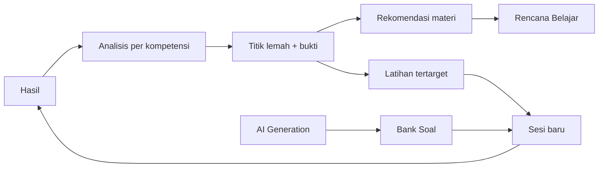

# Product Requirements Document — TryoutSim

Status: planning baseline · Date: 2026-11-07 · Owner: user (Sakbanullah)

Canonical sources referenced here, never restated: exam rules [CPNS_2026_REGULATIONS.md](../examination/CPNS_2026_REGULATIONS.md) ·
competency ids [COMPETENCY_TAXONOMY.md](../examination/COMPETENCY_TAXONOMY.md) ·
scoring [SCORING_METHODOLOGY.md](../examination/SCORING_METHODOLOGY.md) ·
question model [QUESTION_SPECIFICATION.md](../examination/QUESTION_SPECIFICATION.md) ·
AI provider layer [AI_PROVIDER_ARCHITECTURE.md](../ai/AI_PROVIDER_ARCHITECTURE.md).

---

## 1. Product vision

A private, local-first drill room for the Indonesian CPNS academic selection. The user studies on
their own machine, with their own AI provider, and the app keeps an honest record of what they know
and what they don't.

## 2. Problem

CPNS preparation material is plentiful but untrustworthy: questions are recycled, explanations are
shallow, "official" labels are applied loosely, and performance feedback is a score without a next
step. The learner does not know *which competency* is costing marks, or whether last month's practice
changed anything.

## 3. Objectives

| ID | Objective | Measure |
|---|---|---|
| O-1 | Honest content labelling | 0 UI surfaces present AI questions as official; every question carries provenance |
| O-2 | Diagnose, not just grade | Every session produces per-competency evidence with sample size |
| O-3 | Close the loop | Every identified weakness leads to a recommended material and a targeted drill |
| O-4 | Measure improvement | Trend per competency over ≥ 3 sessions shows direction with a stated confidence caveat |
| O-5 | Provider independence | Switching provider/model requires no change to examination, analytics or recommendation logic |
| O-6 | Local and private | Runs with no cloud account; API keys never reach the browser |

## 4. Target user

One person: a CPNS candidate preparing on a personal laptop, comfortable installing a local web app,
likely using a gateway (e.g. 9Router, OpenRouter, or a local Ollama instance) for generation. Reads
Indonesian. Studies in short sessions at unpredictable times.

Non-goals: multi-user accounts, teacher dashboards, mobile native apps, paid content.

## 5. Concept and language (Indonesian-first)

The product uses CPNS vocabulary and, where sensible, exam-room language:

| Product term | Indonesian UI |
|---|---|
| Try Out | **Try Out** |
| Practice | **Latihan** |
| Question bank | **Bank Soal** |
| Session | **Sesi** |
| Attempt / result | **Hasil** |
| Competency | **Kompetensi** |
| Weakness | **Titik Lemah** |
| Study plan | **Rencana Belajar** |
| AI practice badge | **Latihan AI — bukan soal resmi** |
| Historical archive badge | **Arsip {tahun} — bukan soal siklus berjalan** |

## 6. Core use cases

| UC | Name | Actor | Outcome |
|---|---|---|---|
| UC-01 | Generate questions for a competency | user + AI provider | New draft questions in Bank Soal |
| UC-02 | Run a full try out | user | Timed session, auto-submit, immediate score |
| UC-03 | Run a targeted practice drill | user | Untimed drill on selected competencies |
| UC-04 | Review a result | user | Per-question review with explanations |
| UC-05 | Diagnose weaknesses | user | Competency breakdown with sample sizes |
| UC-06 | Receive recommendations | system | Ordered list of materials and drills, each with a stated reason |
| UC-07 | Follow a study plan | user | Daily/weekly plan adjusting to new results |
| UC-08 | Manage the question bank | user | Search, filter, activate, archive, regenerate |
| UC-09 | Configure an AI provider | user | Provider saved, connection verified, task→model mapped |
| UC-10 | Approve a provisional exam config | user | Scored sessions unlocked with a recorded approval |

Full narratives: [USER_STORIES.md](./USER_STORIES.md) · [USER_JOURNEYS.md](./USER_JOURNEYS.md).

## 7. Learning loop (the product's spine)

Every feature must be justified by where it sits in this loop. Anything that does not feed or draw
from the loop is out of MVP scope.

## 8. Functional requirements

### 8.1 Dashboard
- FR-D1 Show latest session result, overall accuracy, and per-test scores.
- FR-D2 Show competency-level accuracy for competencies with ≥ 5 answered questions; below that,
  show the metric as unavailable with the reason.
- FR-D3 List the 3 weakest competencies with the evidence that identified them.
- FR-D4 Show recent session history (last 10) with config badge.
- FR-D5 Show pending actions: draft questions awaiting review, unapproved provisional configs,
  provider not configured.

### 8.2 Try Out
- FR-T1 Start a session from an exam config with the config's `notice` shown first.
- FR-T2 Countdown timer; auto-submit on expiry; server/browser agree on remaining time from a
  deadline timestamp, not a tick counter.
- FR-T3 Navigate between questions (number grid, next/previous), flag questions for review.
- FR-T4 Autosave answers; resuming a session after a reload restores state exactly.
- FR-T5 Submit explicit; confirm dialog lists unanswered count.
- FR-T6 Score immediately and show result summary; do not show per-question answers until review.
- FR-T7 If scoring is blocked (approval invalidated mid-session), save answers as `unscored` and
  explain why.

### 8.3 Practice (Latihan)
- FR-P1 Select competencies by any level (test → domain → leaf) and difficulty.
- FR-P2 Choose length; untimed by default, with an optional per-question soft timer.
- FR-P3 Same runner as Try Out minus the session deadline.
- FR-P4 Show explanations inline after each question (practice only).

### 8.4 AI question generation
- FR-G1 Generate N questions for a competency/competency set, difficulty, and exam config.
- FR-G2 Show a progress view with per-batch status and a cancel action.
- FR-G3 Route each draft through the full validation set ([QUESTION_SPECIFICATION.md](../examination/QUESTION_SPECIFICATION.md) §5).
- FR-G4 Present drafts for review: accept, edit, reject, regenerate one or all.
- FR-G5 Record provenance including provider, model, prompt template version and generation id.
- FR-G6 Surface failures with a category and a retry action; never silently drop a batch.

### 8.5 Performance analysis
- FR-A1 Per-test, per-competency accuracy and mean response time.
- FR-A2 Historical trend per competency with a minimum-sample warning below threshold.
- FR-A3 Difficulty analysis: accuracy by author-assigned difficulty.
- FR-A4 Distinguish "not enough data" from "zero correct". A competency with 2 answered questions
  must not outrank one with 40.
- FR-A5 Show the config(s) sessions were scored under; never compare scores across incompatible configs
  without saying so.

### 8.6 Personalized learning
- FR-L1 Identify weaknesses using the rule set in [RECOMMENDATION_ENGINE.md](../ai/RECOMMENDATION_ENGINE.md).
- FR-L2 State *why* each weakness was identified (numbers, not adjectives).
- FR-L3 Recommend learning material per weakness (AI-generated or user-authored), always labelled.
- FR-L4 Offer a targeted drill built from the recommendation.
- FR-L5 Build a daily/weekly plan with estimated effort, editable by the user.
- FR-L6 Recompute on each new result; do not silently discard a plan the user edited — propose changes.

### 8.7 Question bank
- FR-Q1 List with filters: test, competency, difficulty, lifecycle, provenance, config, search text.
- FR-Q2 Row detail shows all validation checks and review history.
- FR-Q3 Transitions per lifecycle rules; illegal transitions disabled with a reason.
- FR-Q4 Bulk archive; bulk activate only for questions whose validation passes.
- FR-Q5 Show duplicate and near-duplicate clusters.

### 8.8 AI configuration
- FR-C1 CRUD providers (name, base URL, key, headers, timeout, retries, parameters).
- FR-C2 Test connection; show the exact error text returned by the provider.
- FR-C3 Fetch or list available models; allow manual entry when listing is unsupported.
- FR-C4 Map generation tasks (question, explanation, material, analysis) to a provider+model.
- FR-C5 Capability flags per model: JSON mode, streaming, max context — user-editable with defaults.
- FR-C6 Key is write-only from the UI; only a masked tail is ever displayed.
- FR-C7 All non-AI features work when no provider is configured.

### 8.9 Exam configuration & approval
- FR-E1 Show the available configs and their state.
- FR-E2 Show a provisional config's basis, unresolved items, and notice.
- FR-E3 Approve with the four bound values visible; record the approval.
- FR-E4 Invalidate approval automatically on any change; block scoring until re-approved.

## 9. Non-functional requirements

| ID | Requirement |
|---|---|
| NFR-1 | Local-first: no network calls except to the configured AI provider |
| NFR-2 | First contentful paint < 1.5 s on the user's machine for cached local data |
| NFR-3 | Session state survives reload and browser crash (autosave ≤ 2 s, deadline-based timer) |
| NFR-4 | Keyboard operable: every exam action reachable without a mouse |
| NFR-5 | WCAG 2.1 AA contrast in both themes |
| NFR-6 | Deterministic scoring; identical inputs produce identical outputs |
| NFR-7 | No secrets in bundle, localStorage of secrets, logs, or docs |
| NFR-8 | Responsive down to 360 px width; exam layout prioritises a phone-width reading column |
| NFR-9 | Data survives app updates (migration strategy in backend docs) |
| NFR-10 | Frontend renders meaningfully with an empty database |
| NFR-11 | Every factual exam claim traceable to `CPNS_2026_REGULATIONS.md` |

## 10. Constraints

- Single user, no auth by default (see [SECURITY.md](../architecture/SECURITY.md) and
  [AUTHENTICATION.md](../backend/AUTHENTICATION.md)).
- Backend not implemented before explicit frontend approval.
- No automated frontend tests; manual verification by the user.
- No AI provider required for non-AI features.
- No claim of "official 2026" content — see regulations §1.

## 11. MVP scope

In scope: the nine feature areas of §8 at the depth described, running on mock data in the frontend.
Out of scope: multi-device sync, shareable results, PDF export, image generation for figural items
(placeholder assets only at first), spaced-repetition scheduling beyond a simple due-date plan.

Detail and cut lines: [MVP_SCOPE.md](./MVP_SCOPE.md) · feature matrix: [FEATURE_MATRIX.md](./FEATURE_MATRIX.md).

## 12. Success metrics

| Metric | Target |
|---|---|
| Sessions completed per week during a study month | ≥ 4 |
| Weaknesses that lead to a recommended material and a drill | 100% of surfaced weaknesses |
| Competencies with a measured trend after 3 sessions | ≥ 60% of touched competencies |
| Review time per AI question | ≤ 60 s median (drives batch sizing in generation) |
| Label violations (AI content shown as official) | 0 |

## 13. Acceptance criteria (product level)

1. A new user can go from empty state → configured provider → generated questions → first try out
   without reading source code.
2. A result screen always answers: what did I score, on what, and what should I do next.
3. No screen shows a weakness without showing the sample size behind it.
4. No screen shows a pass/fail verdict from an unapproved provisional config.
5. Killing the browser mid-session loses no answer.
6. Switching provider changes only AI outputs, never scoring or analytics.

## 14. Risks to the product (summary)

Regulatory uncertainty (UNV-01…UNV-08) is the dominant risk and shapes the configuration model.
Full register: [RISK_REGISTER.md](../roadmap/RISK_REGISTER.md).
