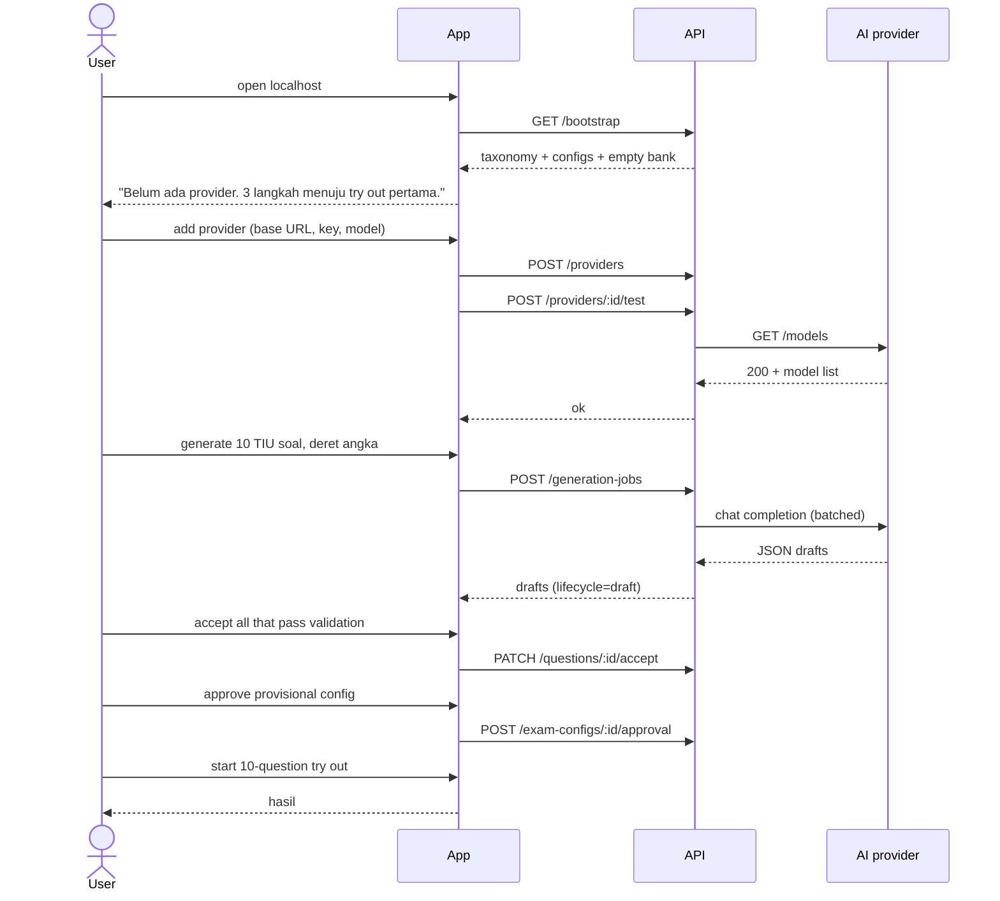
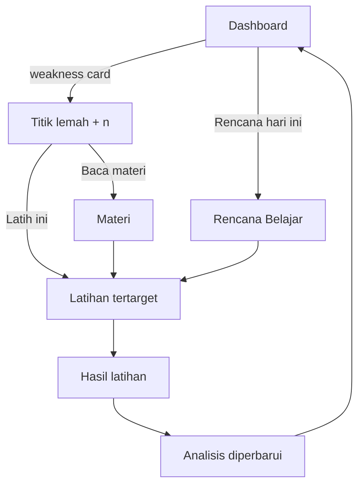
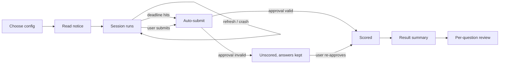
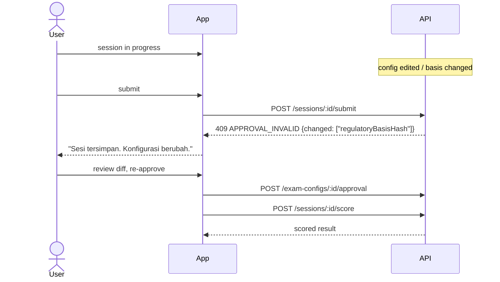
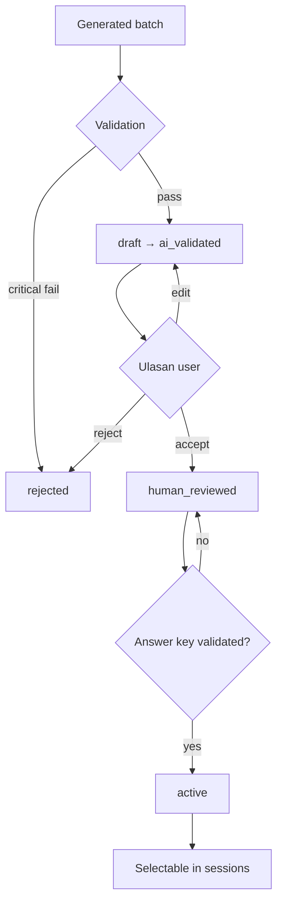
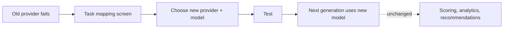

# User Journeys

Narrative + Mermaid for the flows that carry the product. Stories: [USER_STORIES.md](./USER_STORIES.md).
Rules: [CPNS_2026_REGULATIONS.md](../examination/CPNS_2026_REGULATIONS.md).

---

## J-1 First run → first scored try out

The empty-state journey. This is the acceptance path in [PRD.md](./PRD.md) §13.

Decision points that must not be skipped:

1. **Provider not configured** → the empty state still lets the user go to Try Out and Practice with
   whatever questions exist. AI is additive, never a gate ([PRD.md](./PRD.md) FR-C7).
2. **No active questions for the chosen filter** → offer "Latih dengan bank yang ada" or "Buat soal".
   Never a dead end.
3. **Config unapproved** → Start is disabled with the exact warning, and a one-click "Setujui" path.
4. **Zero questions answered** → no result screen; back to practice.

---

## J-2 Daily practice loop

The loop must close within one screen transition per arrow. If a user has to remember a competency
name to act on it, the journey is broken.

---

## J-3 Full try out under time pressure

Key promises: the timer is deadline-based (a refresh cannot add time), autosave is ≤ 2 s, and a
scoring failure never destroys answers.

---

## J-4 Recovering from an invalidated approval

The 409 names **which** of the four bound values changed. That is the difference between a
trustworthy gate and an annoying one.

---

## J-5 Reviewing AI drafts before they can be practised

No path from `draft` to `active` skips the user. This is the structural guarantee behind
[QUESTION_SPECIFICATION.md](../examination/QUESTION_SPECIFICATION.md) §3.

---

## J-6 Provider swap

The dotted edge is the product promise: only AI output changes ([PRD.md](./PRD.md) O-5, §13.6).

---

## Journey-level failure modes

| Failure | Must happen | Must not happen |
|---|---|---|
| Provider unreachable | Category + retry; drafts already created stay | Silent empty result |
| Generation returns broken JSON | Batch marked failed, raw response viewable | Partial writes to the bank |
| Session crash | State restored | Lost answers |
| Approval invalidated | Answers kept, re-approval path | Re-scoring under new rules silently |
| Empty question bank | Clear CTA to generate or browse | Blank screen |
| Only 2 answers on a competency | "Belum cukup data" | A ranked weakness claiming certainty |
