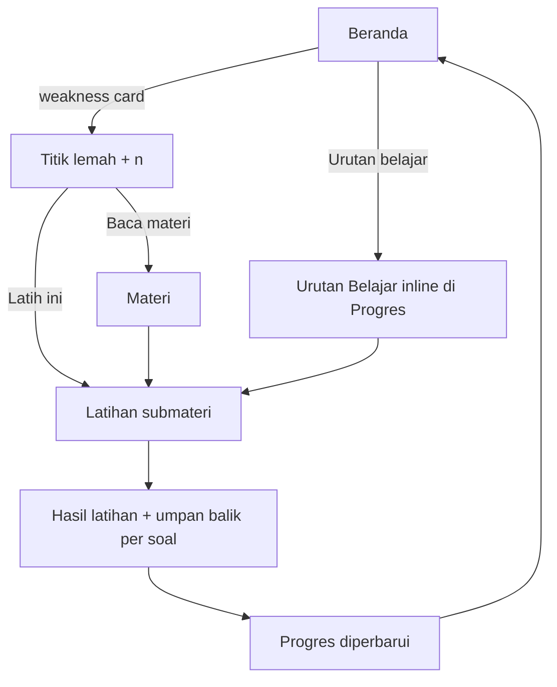
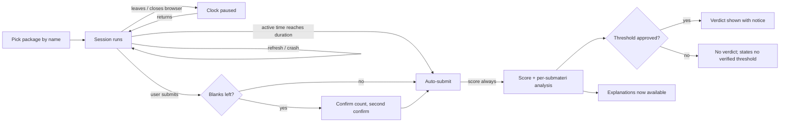
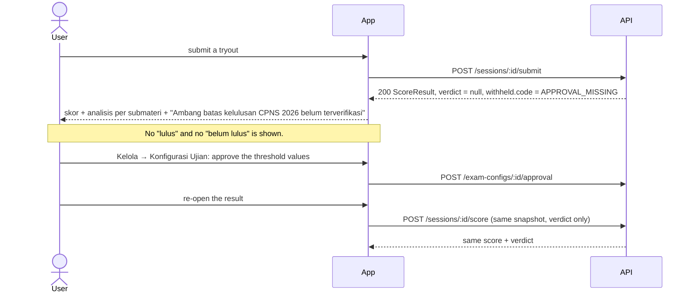
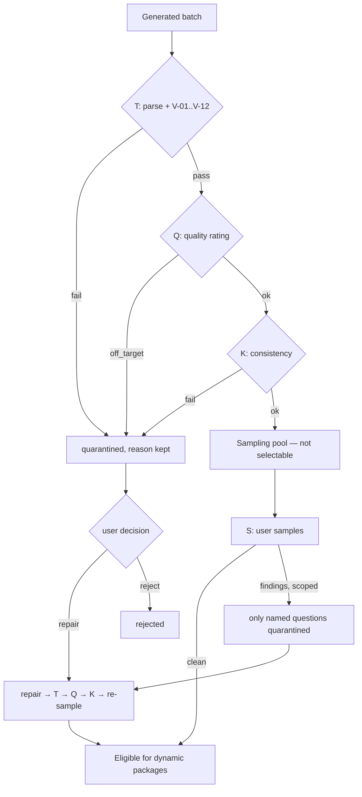
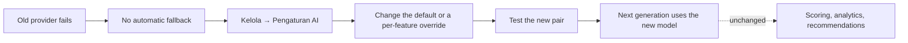

# User Journeys

Narrative + Mermaid for the flows that carry the product. Stories: [USER_STORIES.md](./USER_STORIES.md).
Rules: [CPNS_2026_REGULATIONS.md](../examination/CPNS_2026_REGULATIONS.md). Packages:
[PACKAGE_SPECIFICATION.md](./PACKAGE_SPECIFICATION.md). Navigation:
[FRONTEND_INFORMATION_ARCHITECTURE.md](../frontend/FRONTEND_INFORMATION_ARCHITECTURE.md) §4.

---

## J-1 First run → first scored tryout

The empty-state journey. This is acceptance path 1 in [PRD.md](./PRD.md) §14.

```mermaid
sequenceDiagram
  actor U as User
  participant App
  participant API
  participant P as AI provider
  U->>App: open localhost (launcher started both)
  App->>API: GET /bootstrap
  API-->>App: taxonomy + packages + empty bank + unread count
  App-->>U: "Belum ada provider. 3 langkah menuju tryout pertama."
  U->>App: Kelola → Pengaturan AI: add provider (preset, base URL, key, model)
  App->>API: POST /providers, then POST /providers/:id/test
  API->>P: smoke call + capability probe
  P-->>API: 200, model list
  API-->>App: ok + capabilities
  U->>App: Kelola → Generasi AI: 10 TIU soal, deret angka
  App->>API: POST /generation-jobs
  API-->>App: 202 job (backend keeps running)
  API->>P: chat completion (batched)
  P-->>API: JSON drafts
  API->>API: T → Q → K per question; notification batch_awaiting_sampling
  U->>App: open the sampling notification, review sample, mark clean
  App->>API: POST /question-batches/:batchId/sample { outcome: clean }
  API-->>App: questions eligible
  U->>App: Belajar → Tryout → "Simulasi SKD Lengkap"
  App->>API: POST /packages/:id/sessions
  API-->>App: session + runner (config bound server-side, never chosen)
  U->>App: answer, submit
  App-->>U: hasil: skor + kekuatan/kelemahan per submateri + rekomendasi
```

Decision points that must not be skipped:

1. **Provider not configured** → the empty state still lets the user go to Tryout and Latihan with
   whatever questions exist. AI is additive, never a gate ([PRD.md](./PRD.md) FR-C7).
2. **No eligible stock for a package** → the package states the shortfall and offers the alternative
   (Latihan on another submateri, or "Buat soal"). Never a dead end.
3. **No verified 2026 instrument** → the session starts on the temporary config without asking anything.
   The result states that no passing threshold is verified. There is no "Setujui" gate in front of the
   start ([CPNS_2026_REGULATIONS.md](../examination/CPNS_2026_REGULATIONS.md) §4.2).
4. **Zero questions answered** → no result screen; back to the package picker.

---

## J-2 Daily practice loop



The loop must close within one screen transition per arrow. If a user has to remember a competency
name to act on it, the journey is broken.

---

## J-3 Full tryout under time pressure



Key promises: the clock is **accumulated active time** (leaving cannot consume it and a refresh cannot
add it), autosave is ≤ 2 s and carries the clock, and a result is always produced — only the verdict is
conditional.

---

## J-4 A result with no verdict (unapproved or drifted thresholds)



The `200` result's `withheld.code` names **which** condition suppressed the verdict, and `withheld.changed[]`
names the bound values that drifted. That is the difference between a trustworthy gate and an annoying one.
`POST /sessions/:id/score` scores the frozen snapshot — answers are never re-submitted, and a stored result
may only gain a verdict if every score field stays identical
([API_SPECIFICATION.md](../backend/API_SPECIFICATION.md) §7.3).

---

## J-5 Reviewing an AI batch before it can be practised



No path from `draft` to selectable skips both the user's acceptance and the sampling gate. This is the
structural guarantee behind [QUESTION_SPECIFICATION.md](../examination/QUESTION_SPECIFICATION.md) §3 and
§6.

---

## J-6 Reporting a bad question after it has been used

```mermaid
sequenceDiagram
  actor U as User
  participant App
  participant API
  U->>App: report question (critical: wrong key)
  App->>API: POST /questions/:id/reports { severity: critical, category: wrong_key }
  API->>API: question → quarantined immediately; notification question_quarantined
  API-->>App: accepted
  Note over API: Any session that already froze the question is unaffected.
  U->>App: Kelola → Review Soal: repair the key
  App->>API: PATCH /questions/:id (new contentVersion)
  API->>API: T → Q → K; sampling reset to pending
  U->>App: re-sample
  App->>API: POST /question-batches/:batchId/sample
  API-->>App: eligible again
```

---

## J-7 Provider swap



The dotted edge is the product promise: only AI output changes ([PRD.md](./PRD.md) O-5,
[PRD.md](./PRD.md) §14 item 6).

---

## J-8 Backup, restore, and deleting history

```mermaid
flowchart TD
  A[Kelola → Pengaturan: backup folder] --> B[Automatic / manual run]
  B --> V{Archive written and verified?}
  V -->|yes| OK[Record success, prune per retention]
  V -->|no| FAIL[Record failure + notification, never "success"]
  R[Restore archive] --> C{Compatibility valid?}
  C -->|no| STOP[Refuse, nothing written]
  C -->|yes| P[Preview what is replaced]
  P --> CONFIRM[Confirm]
  CONFIRM --> W[Copy live DB aside, migrate forward, swap]
  W --> K[Keys absent: re-enter each key]
  D[Delete a session] --> IMP[Show what will change in analysis]
  IMP --> DC[Confirm]
  DC --> DEL[Delete session + snapshot + answers + result; keep tombstone]
```

---

## Journey-level failure modes

| Failure | Must happen | Must not happen |
|---|---|---|
| Provider unreachable | Category + manual retry; drafts already created stay | Silent empty result, or a silent switch to another provider |
| Generation returns broken JSON | Batch marked failed, raw response viewable | Partial writes to the bank |
| Browser closed mid-job | Job continues; notification on completion | Lost job, duplicate questions |
| App restart mid-job | Safe batches resume; unsafe batches `interrupted` with retry | Claim the provider request resumed |
| Session crash / browser close | State restored; clock paused meanwhile | Lost answers, consumed time |
| Thresholds unapproved | Score shown, verdict absent, reason stated | A fabricated "lulus/belum lulus" |
| Empty question bank | Clear CTA to generate, write, or drill elsewhere | Blank screen |
| Only 2 answers on a submateri | "Belum cukup data" | A ranked weakness claiming certainty |
| Backup folder unavailable | Failed run + notification | "Backup berhasil" |
| History deleted | Consequences shown first; tombstone explains the empty panel | Silent disappearance of analysis |
